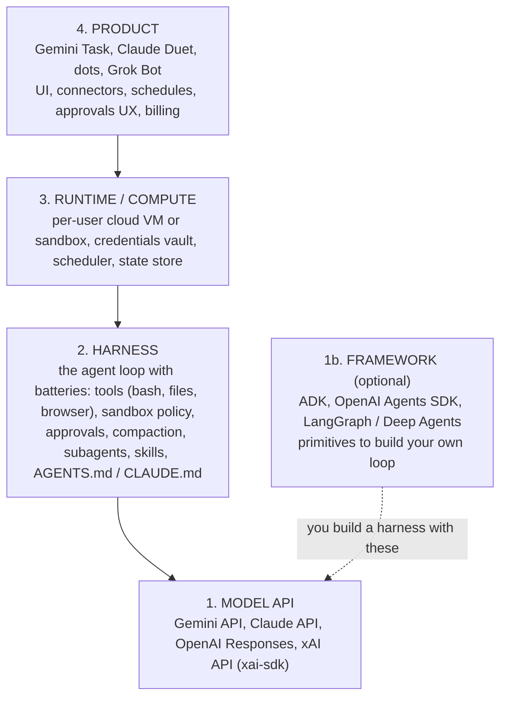
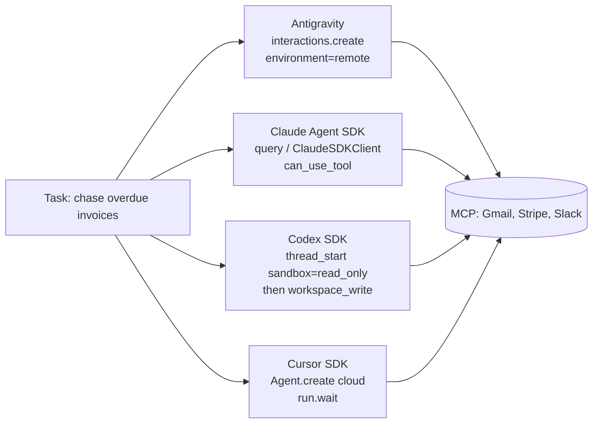

# Understand.md: what each personal agent is really built on

Written Nov 26 2026 as a companion to the `personal-agents-deep-dive` repo.

The question behind this file:

> Gemini Task uses Google ADK, Claude Duet uses the Claude Agent SDK, OpenAI dots uses the OpenAI Agents SDK. Is Grok Bot built the same way on some xAI agent SDK?

The short answer is that the pattern is right and some of the pairings are wrong. That includes pairings my own repo implied: the examples there use these SDKs to rebuild each product, and I didn't flag strongly enough that rebuilding a product with an SDK isn't the same as the product being built on it.

---

## 1. The one-paragraph answer

Every lab ships its personal agent as a **product on top of its own agent harness**, and then sells developers the same harness, or something close to it. The harness is the battle-tested loop: tool calling, a sandboxed computer, file editing, context compaction, approvals. The frameworks people usually name (ADK, the OpenAI Agents SDK, LangGraph) are a layer *below* that. They give you building blocks, and you build the loop and the computer yourself.

| Product | Runs on (publicly stated) | Closest thing a developer can use | Python |
|---|---|---|---|
| **Gemini Task** (Spark) | **Antigravity agent harness** + Gemini 3.5 Flash, on dedicated Google Cloud VMs | Antigravity **Managed Agents** (Interactions API), Antigravity SDK | `google-genai` -> `client.interactions.create(agent="antigravity-...")` |
| **Claude Duet** | Anthropic's agent stack; uses the same memories, skills and connectors as Claude, built on the framework that also guides Claude Code | **Claude Agent SDK**, which *is* the Claude Code harness as a library | `claude-agent-sdk` |
| **OpenAI dots** | Grew out of OpenAI's agentic coding tools; much of it is reachable through Codex | **Codex harness** (app-server / Codex SDK) | `openai-codex` |
| **Grok Bot** | Runs on Cursor's cloud and uses Cursor sign-in; xAI hasn't published which harness | **Cursor SDK harness** (`cursor-sdk`, Agent SDK `@grok/agent-sdk`). `xai-sdk` is the model API, not a harness | `cursor-sdk` (+ `xai-sdk` for the model) |

Corrections to the assumption in the question:

* **Gemini Task is not ADK.** Google says Spark runs on the **Antigravity** harness. ADK is Google's open framework for building your *own* multi-agent systems; Antigravity is the harness Google runs its own agents on, and it's now open to developers as Managed Agents and the Antigravity SDK.
* **dots is closer to Codex than to the Agents SDK.** OpenAI's own framing is that dots came out of its coding agents. The Codex harness, exposed through the app-server and the Codex SDK, is the reusable loop. The OpenAI Agents SDK is a lightweight framework next to it.
* **Duet and the Claude Agent SDK are the closest match of the four.** Anthropic hasn't said "Duet is built on the Agent SDK", but the Agent SDK is the Claude Code harness, and Duet sits on the same agent framework, memories, skills and connectors.
* **Grok Bot does have an "SDK cousin", but it's Cursor's, not xAI's.** That's because Grok Bot runs on Cursor's infrastructure.

How confident is each row?

| Pairing | Confidence | Why |
|---|---|---|
| Gemini Task -> Antigravity | **High** | Stated by Google at I/O, in the keynote, and on the Spark FAQ |
| Grok Bot -> Cursor infra | **High** for the infrastructure, **medium** for the harness | Cursor's docs say Bots run in Cursor's cloud with Cursor auth; nobody has said "Grok Bot uses the Cursor SDK harness" |
| dots -> Codex harness | **Medium** | OpenAI says dots evolved from its coding tools and that Codex can reach most of it; no "built on app-server" statement |
| Duet -> Claude Agent SDK harness | **Medium** | Same trustworthy-agents framework as Claude Code; same skills and connectors; no explicit statement |

---

## 2. Four layers, so the words stop colliding



* A **model API** answers one request. Tool calling here means the model *asks* for a tool and you run it. xAI's API also runs some tools server-side (web search, X search, code execution), which is agentic but still a request/response API.
* A **framework** (ADK, OpenAI Agents SDK, LangGraph) gives you `Agent`, `Tool`, `Runner`, sessions, callbacks and multi-agent patterns. You supply the tools, the computer and the policies.
* A **harness** is a finished loop with a computer attached. Claude Code, Codex, Antigravity and Cursor's agent all have one. They come with shell and file tools, a sandbox, approvals, long-context management and subagents, tuned against the lab's own models.
* A **product** wraps the harness in a persistent per-user runtime (a VM that stays on), connectors to your apps, triggers (schedules, heartbeats), and a consumer UI.

Personal agents are layer 4 on top of layer 2. That's why the companies that already had a strong coding-agent harness (Anthropic, OpenAI, Google, Cursor) could ship personal agents quickly: a coding agent is already a "do long tasks on a computer" agent.

---

## 3. Vendor by vendor

### 3.1 Google: Gemini Task on Antigravity

**What Google says.** Spark (now Task) runs on Gemini 3.5 Flash and the Antigravity agent harness, on dedicated Google Cloud VMs, so it keeps working with your laptop closed. Antigravity is one harness exposed through four surfaces: the Antigravity desktop app, the CLI (successor to Gemini CLI), the SDK, and the original IDE. Improvements land in all of them at once.

**What developers get.**

* **Managed Agents (Gemini API, Interactions API).** One call provisions a remote Linux sandbox and runs the agent loop: code execution (Bash, Python, Node), file management with files persisting across interactions, web browsing. Context is compacted automatically around 135k tokens. You resume with `previous_interaction_id` (conversation) and an environment ID (sandbox state). You can save a configured agent with an `AGENTS.md` and skills pulled from a repo. On Google Cloud's Agent Platform you can also override MCP servers per interaction.
* **Antigravity SDK.** Programmatic access to the same harness to host on your own infrastructure.
* **ADK** stays the open framework for building your own multi-agent systems (Sequential/Parallel/Loop agents, callbacks, sessions). It's great, but it isn't what Task runs on.

```python
# pip install google-genai      export GEMINI_API_KEY=...
from google import genai

client = genai.Client()
interaction = client.interactions.create(
    agent="antigravity-preview-09-2026",          # Google's general-purpose managed agent
    input="List overdue invoices in invoices.csv and draft a friendly reminder for each.",
    environment="remote",                         # fresh Google-hosted Linux sandbox
)
print(interaction)   # result, plus environment_id to reuse the same sandbox
```

**So to build something Task-like:** use a Managed Agent for the "computer + loop" part, add your Workspace connectors through MCP, and put a scheduler in front of it (Cloud Scheduler). Use ADK when you want to choreograph several agents yourself.

### 3.2 Anthropic: Claude Duet and the Claude Agent SDK

**What Anthropic says.** Duet is a proactive Claude you message like a person. It uses the same memories, skills and connectors as regular Claude, keeps working on a cloud computer after the app closes, checks connected accounts every few hours, and draws on the trustworthy-agents framework that also guides Claude Code and Claude in Chrome.

**What developers get.** The **Claude Agent SDK** is the Claude Code harness as a library (it was called the Claude Code SDK until Sep 2025). It comes with built-in file, bash and web tools, in-process MCP tools, subagents (`AgentDefinition`), hooks (`PreToolUse`/`PostToolUse`), permission callbacks, sessions and resume, skills, sandboxing and budgets.

```python
# pip install claude-agent-sdk    export ANTHROPIC_API_KEY=...
import anyio
from claude_agent_sdk import query, ClaudeAgentOptions

async def main():
    opts = ClaudeAgentOptions(permission_mode="default", max_turns=20, cwd=".")
    async for msg in query(prompt="List overdue invoices in invoices.csv and draft reminders.", options=opts):
        print(msg)

anyio.run(main)
```

**So to build something Duet-like:** the Agent SDK plus a scheduler (every few hours, plus a morning brief), MCP connectors, and a `can_use_tool` callback that turns approvals into push or Slack messages. That's `services/s03_claude_duet` in the repo.

### 3.3 OpenAI: dots, the Codex harness, and where the Agents SDK fits

**What OpenAI says.** dots came out of the agentic coding tools OpenAI built for engineers, and much of what dots does can be reached with Codex, with more setup. dots can be launched from Codex or ChatGPT, and it acts on a separate cloud machine.

**What developers get.**

* **Codex harness.** OpenAI describes a single Codex harness (the agent loop plus its logic) behind the web app, CLI, IDE extension and macOS app. The **app-server** exposes it over JSON-RPC so other products can reuse it, and OpenAI now pitches it as a platform: threads, turns, events, approval requests, sandbox policies.
* **Codex SDK (Python).** Drives the local app-server: `thread_start(sandbox=...)`, `thread.run(...)`.
* **OpenAI Agents SDK.** A light framework (agents, tools, handoffs, guardrails) on the Responses API. Good for your own apps, but it isn't the harness dots grew out of.

```python
# pip install openai-codex
from openai_codex import Codex, Sandbox

with Codex() as codex:
    thread = codex.thread_start(sandbox=Sandbox.workspace_write)
    result = thread.run("List overdue invoices in invoices.csv and draft reminders as .md files.")
    print(result.final_response)
```

**So to build something dots-like:** the Codex harness for the loop and computer, a cloud VM to run it on, connectors through MCP, and read-only sandboxing for background passes (`Sandbox.read_only`), which matches dots' rule that unprompted research uses read-only tools.

### 3.4 xAI: Grok Bot, and why its "SDK" lives at Cursor

**What xAI and Cursor say.**

* xAI's design write-up defines a Bot as a persistent agent with its own identity, memory, runtime and tools. Bots have chats, prompts (used once, saved as Skills, or triggered as Routines), tools (APIs, connectors, shell, computer use) and artifacts.
* You follow a Bot's computer at three levels: a status icon, a preview panel, and full-screen takeover.
* Scope: Tools and Skills belong to the account and are shared across Bots; Memory and Routines belong to each Bot. Limits are about 50 Bots per account and six per group chat.
* A common pattern is a "Chief of Staff" Bot that coordinates specialist Bots and escalates decisions to you.
* Cursor's docs say Bots work on a persistent cloud computer in Cursor's cloud, and Grok Bot uses Cursor authentication.
* The design write-up **doesn't name a harness or model stack**.

**What developers get.** Two different things, and the naming makes them easy to confuse:

| Package | What it is | Layer |
|---|---|---|
| `xai-sdk` (Python) | Client for the xAI API: chat, function calling, and server-side tools (`web_search`, `x_search`, `code_execution`) | Model API |
| `cursor-sdk` (Python) | Runs Cursor's agent from your code, on a local working tree or in a Cursor cloud VM | Harness |
| `@grok/agent-sdk` (npm, formerly `@cursor/bdk`) | Agent SDK: agents as code (Markdown + TypeScript), on the **Cursor SDK harness** that powers Bugbot, Security Review, Approval Bot and Rollouts; deploy on Cursor hosting or your own | Harness + product scaffolding |

Cursor's own docs set **Cursor Automations**, **Grok Bot** and **Agent SDK** side by side:

| | Cursor Automations | Grok Bot | Agent SDK |
|---|---|---|---|
| You define | a prompt, model and trigger in the dashboard | instructions, skills and connected tools in the app | a versioned Markdown + TypeScript project |
| Choose it when | the job fits a schedule or event | you want to configure and talk to an agent without code | you want code around model judgment you can version, review, test |

That table answers the question as directly as anything published: **Grok Bot is the no-code member of Cursor's agent family, and Agent SDK is the code-first member.** It's a reasonable inference that they share the Cursor harness, but neither xAI nor Cursor has said it in those words.

There's still no API for driving Grok Bot itself (list or create bots, send a message, read the reply). Cursor staff confirmed that on the Cursor forum.

```python
# Harness path: the closest official programmable sibling of Grok Bot
# pip install cursor-sdk      export CURSOR_API_KEY=crsr_...
from cursor_sdk import Agent, CloudAgentOptions

with Agent.create(cloud=CloudAgentOptions(repos=[])) as agent:   # Cursor-hosted VM
    run = agent.send("Research the top 3 invoice-reminder best practices and summarize.")
    print(run.wait().result)
```

```python
# Model path: Grok as the brain of your own loop
# pip install xai-sdk         export XAI_API_KEY=...
from xai_sdk import Client
from xai_sdk.chat import user
from xai_sdk.tools import web_search, x_search, code_execution

chat = Client().chat.create(model="grok-4.7", tools=[web_search(), x_search(), code_execution()])
chat.append(user("Any public posts this week about Northwind Ltd payment delays?"))
print(chat.sample().content)          # server-side tools ran on xAI's side
```

> **Correction to the repo.** The `s01_grok_bot` mock models all Bots on one *shared* computer. xAI's design article says each Bot has its own virtual computer, while Cursor's docs talk about "the shared computer" and xAI warns that separate Bots aren't separate security boundaries. Sources disagree, so treat the shared-computer detail in the mock as one reading, not a fact. What is consistent across sources: Skills and Tools are account-level and Memory is per Bot. The mock gets that part right.

---

## 4. The four harnesses side by side

| | **Claude Agent SDK** | **Codex (app-server / SDK)** | **Antigravity (Managed Agents / SDK)** | **Cursor SDK / Agent SDK** |
|---|---|---|---|---|
| Vendor | Anthropic | OpenAI | Google | Cursor (Grok Bot's home) |
| Powers | Claude Code (and the agent family Duet belongs to) | Codex web/CLI/IDE/macOS; dots' lineage | Gemini Task/Spark, Antigravity IDE/CLI/app | Cursor agent, Bugbot, Security Review; Grok Bot's runtime family |
| Where the loop runs | your process (spawns the Claude Code runtime) | local app-server process (JSON-RPC) | Google-hosted sandbox (Managed) or your infra (SDK) | local working tree or Cursor cloud VM |
| Computer | your machine / container, with sandbox settings | sandbox presets: read-only, workspace-write, full-access | remote Linux sandbox, persistent across interactions | local tree or isolated cloud VM with repo cloned |
| Built-in tools | files, bash, web, MCP | shell, files, apply-patch, MCP | code exec, files, browsing, MCP | files, terminal, editing, MCP |
| Your tools | `@tool` in-process MCP, any MCP server | MCP, app-provided tools | MCP (overridable per interaction on Agent Platform) | MCP, custom tools |
| Subagents | `AgentDefinition` | spawned threads | parallel sub-agents in the harness | subagents (Agent SDK) |
| Approvals | `can_use_tool`, `permission_mode`, hooks | approval requests over the protocol; `ApprovalMode` | human-in-the-loop guardrails in product surfaces | approval bots, sandbox options |
| Instructions | CLAUDE.md, skills | AGENTS.md | AGENTS.md, skills from repos | rules, skills, `bot/` folder |
| Long context | compaction built in | retained reasoning, compaction | auto-compaction ~135k tokens | managed by harness |
| Python | yes (`claude-agent-sdk`) | yes (`openai-codex`) | yes (`google-genai` Interactions) | yes (`cursor-sdk`); Agent SDK is TypeScript |
| Hosting | you | you | Google (Managed) or you | Cursor or you |

And the frameworks, for contrast:

| | Google ADK | OpenAI Agents SDK | LangChain Deep Agents |
|---|---|---|---|
| Layer | framework | framework | framework with an opinionated harness on LangGraph |
| You get | Agents, workflow agents, Runner, sessions, callbacks | Agents, tools, handoffs, guardrails, sessions | virtual FS backends, subagents (sync and async), skills, interrupts, any model (todo planner opt-in since 0.7) |
| You still build | the computer, the tool sandbox, compaction | the computer, the tool sandbox | the real computer (its FS is virtual by default) |
| Best when | you're orchestrating several agents on Google Cloud | you want the thinnest wrapper over Responses | you need model choice plus long-task structure |

**Rule of thumb.** If the agent needs a *computer* (files, shell, browser, hours of work), start from a harness. If it mainly needs to *route between tools and other agents*, a framework is enough, and often clearer.

---

## 5. Same task, four harnesses

The repo's scenario (chase overdue invoices) mapped onto each harness. The approval hook is the key line in each.



| Step | Antigravity | Claude Agent SDK | Codex | Cursor |
|---|---|---|---|---|
| Start | `interactions.create(agent=..., environment="remote")` | `ClaudeSDKClient(options)` | `codex.thread_start(...)` | `Agent.create(cloud=...)` |
| Connect apps | MCP servers in config | `mcp_servers={...}` | MCP config | MCP connections |
| Gate sending | product-side approval / your MCP tool asks | `can_use_tool` -> deny | approval mode + read-only background turns | approval in your tool / sandbox options |
| Continue later | `previous_interaction_id` + env ID | `resume=session_id` | same thread, next `run()` | `Agent.resume(...)` |
| Run daily | Cloud Scheduler -> interaction | cron -> script | cron -> script | Cursor Automations, or cron |

---

## 6. What this means for the repo

* `s04_gemini_task` uses **ADK** for its live build-alike. That still works, but **Antigravity Managed Agents is the closer match** to how Task actually runs. Use the snippet in 3.1 if you want the real thing.
* `s02_openai_dots` uses the **OpenAI Agents SDK**. The **Codex SDK** (`s17_openai_codex`) is closer to dots' lineage. The Agents SDK version is still a fine way to show the read-only-background design.
* `s03_claude_duet` and `s18_claude_agent_sdk`: the pairing holds.
* `s01_grok_bot`: the `xai-sdk` Bot is "Grok model + your own loop"; the `cursor_cloud_handoff()` path is the closest official sibling of Grok Bot's runtime. Read section 3.4's correction about shared vs per-Bot computers.

---

## 7. One-line summary per company

* **Google**: Task is a product on **Antigravity**; developers get the same harness as Managed Agents. ADK is the separate do-it-yourself framework.
* **Anthropic**: Duet sits on the same agent stack as **Claude Code**; developers get that harness as the **Claude Agent SDK**.
* **OpenAI**: dots grew out of the **Codex** harness; developers get it as the **app-server / Codex SDK**. The Agents SDK is the lighter framework next to it.
* **xAI**: Grok Bot runs on **Cursor's** cloud; developers get Cursor's harness as **cursor-sdk / Agent SDK**, and Grok itself through **xai-sdk**. There is no xAI-branded agent harness SDK, and no Grok Bot API.

---

## Sources

* Google: I/O 2026 developer highlights (blog.google), "Introducing Managed Agents in the Gemini API" (blog.google), Gemini API Antigravity Agent and Managed Agents quickstart (ai.google.dev), Agent Platform "Interact with agents" (docs.cloud.google.com), VentureBeat and The Next Web on Spark's architecture
* Anthropic: "Introducing Claude Duet" (claude.com), Claude Agent SDK reference (code.claude.com/docs/en/agent-sdk/python)
* OpenAI: "Unlocking the Codex harness: how we built the App Server" (openai.com, Feb 4 2026), "Codex as a platform" (developers.openai.com), Codex SDK docs, TechCrunch "How OpenAI turned its coding tools into dots" (Oct 26 2026)
* xAI / Cursor: "Designing Grok Bot" (x.ai/news), Cursor Grok Bot docs (cursor.com/docs/grok-bot), Cursor Agent SDK (cursor.com/docs/agent-sdk), Cursor Python SDK (cursor.com/docs/sdk/python), Cursor forum thread on a Grok Bot API, xAI tools docs (docs.x.ai)
