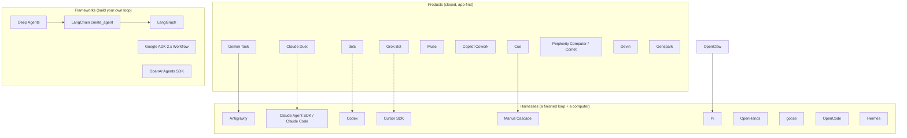
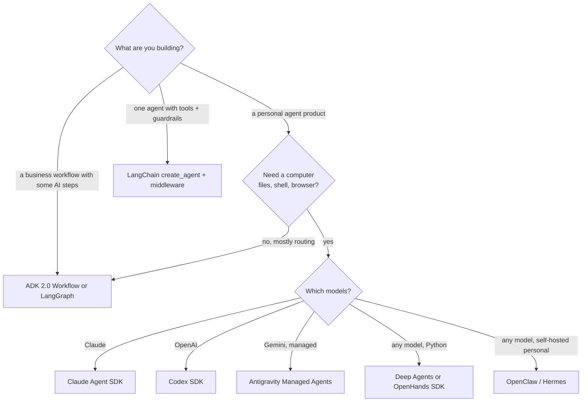

# Personal agents, harnesses and frameworks: the updated deep dive

This is the second edition of the repo. The first edition (`README.md`) covers twenty personal agents and agent platforms on a small shared harness. This edition adds three things:

1. **Harness agents.** What Manus, OpenClaw, Hermes, Genspark, Perplexity Comet/Computer, Cursor, Devin and Codex actually run on, plus the open-source harnesses worth knowing (OpenCode, Pi, goose, OpenHands, Aider, Cline and others). It includes a runnable Pi-style four-tool harness.
2. **Framework deep dives with 28 runnable examples**, run against the real libraries:
   * **LangChain 1.x** (5 examples): `create_agent`, middleware, structured output, memory, multi-agent
   * **LangGraph 1.x** (6): StateGraph, `Send` map-reduce, `interrupt()`, `Command` handoffs, Functional API, time travel and streaming
   * **Deep Agents 0.7** (5): subagents, HITL, backends and long-term memory, skills and AGENTS.md, todos and custom middleware
   * **Google ADK** (5): agents, tools, state, callbacks, `sub_agents`, classic workflow agents, `AgentTool`, MCP
   * **Google ADK 2.0 Workflows** (7): graph routing, fan-out/join, durable HITL, dynamic nodes, retries, single-turn agent nodes, confirmations, and an end-to-end refund use case
3. **Corrections** found while checking the current libraries:
   * Gemini Task runs on Antigravity, not ADK ([Understand.md](Understand.md)).
   * Deep Agents 0.7 removed the todo planner from its default harness.
   * ADK 2.x deprecates `SequentialAgent`/`ParallelAgent`/`LoopAgent` in favor of `Workflow`.

Every example runs **offline**. The frameworks run for real; only the model's replies are scripted, through small `BaseLlm` / `BaseChatModel` subclasses in `frameworks/_fakes/`. Add `--live` and a real model takes over.

Versions checked (late Nov 2026): `langchain 1.5.2`, `langchain-core 1.8.5`, `langgraph 1.2.24`, `deepagents 0.7.42`, `google-adk 2.15.1`, `google-genai 2.34.0`, Python 3.13.

---

## Contents

1. [Quick start](#1-quick-start)
2. [The map: products, harnesses, frameworks](#2-the-map)
3. [Harness agents](#3-harness-agents)
4. [LangChain 1.x](#4-langchain-1x)
5. [LangGraph 1.x](#5-langgraph-1x)
6. [Deep Agents](#6-deep-agents)
7. [Google ADK](#7-google-adk)
8. [Google ADK 2.0 Workflows and what's new](#8-google-adk-20-workflows-and-whats-new)
9. [Same use case, every framework](#9-same-use-case-every-framework)
10. [Choosing](#10-choosing)
11. [Use-case catalogue](#11-use-case-catalogue)
12. [Caveats](#12-caveats)
13. [Sources](#13-sources)

---

## 1. Quick start

Three independent environments, because the LangChain stack and ADK pin different dependency versions:

```bash
# the original 20 personal-agent demos + harness examples: stdlib only
python run_all.py
python harness_agents/examples/pi_style_minimal_harness.py

# LangChain / LangGraph / Deep Agents  (Python 3.11+)
python -m venv .venv-lc && .venv-lc/bin/pip install -r requirements-langchain.txt
.venv-lc/bin/python frameworks/run_all.py

# Google ADK 2.x
python -m venv .venv-adk && .venv-adk/bin/pip install -r requirements-adk.txt
.venv-adk/bin/python frameworks/run_all.py
```

`frameworks/run_all.py` runs every example the current interpreter can import and skips the rest. Expected result: 16 `ok` in the LangChain venv, 12 `ok` in the ADK venv.

Live mode:

```bash
LC_MODEL=anthropic:claude-sonnet-4-6 .venv-lc/bin/python frameworks/langchain/02_middleware_guardrails.py --live
GOOGLE_API_KEY=...                  .venv-adk/bin/python frameworks/google_adk/01_agent_tools_state.py --live
```

New layout:

```
personal-agents-deep-dive/
├── UpdatedREADME.md               <- you are here
├── README.md                      first edition (20 personal agents)
├── Understand.md                  which harness each big personal agent runs on
├── harness_agents/
│   ├── README.md                  8 platforms + open-source harnesses
│   └── examples/                  pi_style_minimal_harness.py, drive_headless_harnesses.py, openhands_sdk_example.py
├── frameworks/
│   ├── _fakes/                    lc_fake.py (ScriptedChatModel), adk_fake.py (ScriptedLlm)
│   ├── langchain/                 01..05 + README.md
│   ├── langgraph/                 01..06 + README.md
│   ├── deep_agents/               01..05 + README.md
│   ├── google_adk/                01..05 + README.md
│   ├── google_adk_workflows/      01..07 + README.md
│   └── run_all.py
├── requirements-langchain.txt, requirements-adk.txt
└── pa_core/, services/, tests/ ...   (first edition)
```

---

## 2. The map



Solid arrows are stated publicly; dotted arrows are close, documented relationships rather than explicit "built on" statements (details in [Understand.md](Understand.md)).

How to read the three layers:

* **Frameworks** give you primitives: agents, tools, state, graphs, callbacks. You decide the loop, the tools and the computer.
* **Harnesses** give you a tuned loop with a computer attached: file and shell tools, sandboxing, approvals, compaction, subagents, sessions.
* **Products** put a harness in a persistent per-user runtime with connectors, schedules and a UI.

Deep Agents is the interesting crossover: a harness you build *with* a framework.

---

## 3. Harness agents

Full write-up: [harness_agents/README.md](harness_agents/README.md).

| Platform | Harness | Open | How to use it from code |
|---|---|---|---|
| Manus | **Cascade** (in-house, Manus 2.0, Sep 2026): starts light, adds tools on demand | no | REST v2 |
| OpenClaw | **Pi** (`pi-mono`), embedded via its SDK, wrapped in a multi-channel gateway | MIT | gateway `/v1/responses` |
| Hermes Agent | its own Python harness with a closed skill-learning loop | MIT | CLI |
| Genspark | mixture-of-agents across several models | no | remote MCP server |
| Perplexity Comet / Computer | multi-model orchestration harness; local versions run on your hardware with an OS sandbox | no | Agent/Search/Sandbox APIs |
| Cursor | **Cursor SDK harness** (Bugbot, Security Review, Grok Bot's runtime family) | no | `cursor-sdk` |
| Devin | proprietary | no | REST v3 |
| Codex | **Codex harness** (Rust "Codex core" + app-server JSON-RPC) | Apache 2.0 | `openai-codex` |

Open source to know: **OpenCode** (most-starred open coding agent of 2026, LSP-aware, provider-agnostic), **Pi** (four tools, self-extending), **goose** (Block -> Linux Foundation's Agentic AI Foundation, MCP extensions, recipes, ACP), **OpenHands Software Agent SDK** (a real Python SDK; local, Docker or remote agent server), **Aider**, **Cline/Roo Code**, **Codex CLI**, **Gemini CLI -> Antigravity CLI**, **SWE-agent**.

Runnable:

```bash
python harness_agents/examples/pi_style_minimal_harness.py     # 4 tools, real files, real shell, offline
python harness_agents/examples/drive_headless_harnesses.py     # finds claude/codex/opencode/goose/aider/... on PATH
```

The Pi-style harness writes a module and a test, runs the test (exit 1, a genuine off-by-one at the 30-day boundary), edits the bug, and reruns (exit 0). It's a real loop on real files, with only the model's decisions scripted.

---

## 4. LangChain 1.x

Folder: [frameworks/langchain](frameworks/langchain/README.md)

**The idea.** LangChain 1.0 refocused the library on the agent loop. `create_agent` is the standard agent and replaced LangGraph's deprecated `create_react_agent`. **Middleware** is how you extend it, and the result is a LangGraph graph.

```python
agent = create_agent(
    model="anthropic:claude-sonnet-4-6",
    tools=[send_email],
    middleware=[
        PIIMiddleware("email", strategy="redact", apply_to_input=True),
        egress_guard,                                        # your @wrap_tool_call
        ToolCallLimitMiddleware(tool_name="send_email", run_limit=2),
        HumanInTheLoopMiddleware(interrupt_on={"send_email": {"allowed_decisions": ["approve", "edit", "reject"]}}),
    ],
    checkpointer=InMemorySaver(),
)
```

| # | Example | Takeaway |
|---|---|---|
| 01 | `create_agent` basics | an agent is a graph: `__start__ -> model <-> tools -> __end__` |
| 02 | middleware guardrails | a human approved the gmail send and the code guard still blocked it: approval and policy are separate layers |
| 03 | structured output | `ToolStrategy(Pydantic)` -> `result["structured_response"]`, typed and routable |
| 04 | memory | threads via checkpointer (short-term), store via `ToolRuntime` (long-term), typed context |
| 05 | multi-agent + resilience | agents as tools; `ToolRetryMiddleware` recovered a failed ledger call |

---

## 5. LangGraph 1.x

Folder: [frameworks/langgraph](frameworks/langgraph/README.md)

**The idea.** Typed state flows through nodes; edges (plain Python) decide what runs next; a checkpointer makes every step durable. Use it directly when you need fixed routes, fan-out, long human waits or replays.

| # | Example | Primitive |
|---|---|---|
| 01 | escalation ladder | `add_conditional_edges` |
| 02 | reminders for every invoice in parallel | `Send` + `Annotated[list, operator.add]` |
| 03 | approve / edit / reject an email | `interrupt()` + `Command(resume=...)` |
| 04 | Chief-of-Staff routing specialists | `Command(goto=...)` handoffs |
| 05 | nightly scoring job | `@entrypoint` / `@task`, interrupt; finished tasks aren't re-run on resume |
| 06 | "what if the tone were firm?" | `get_state_history`, `update_state` fork, stream modes incl. `custom` |

Five of the six run without any model. Most of what makes an agent dependable is the graph around the model.

---

## 6. Deep Agents

Folder: [frameworks/deep_agents](frameworks/deep_agents/README.md)

**The idea.** `create_deep_agent` = `create_agent` + a harness middleware stack: filesystem tools on a pluggable backend, a `task` tool for subagents, summarization, tool-call patching, optional skills, memory, HITL and async subagents.

Version facts that matter:

* **0.7 dropped `write_todos` from the defaults.** Add `TodoListMiddleware()` back if you want a visible plan.
* **0.7 added a recursive delete tool** where the backend supports it; delete counts as a write in permissions.
* **0.5 added async subagents**: non-blocking, stateful, remote; they need a LangSmith Deployment.
* **0.6 added typed streaming** for UIs.

```python
backend = CompositeBackend(default=StateBackend(),
                           routes={"/memories/": StoreBackend(namespace=lambda rt: ("acme", "memories"), store=store)})
agent = create_deep_agent(model=..., tools=[...], subagents=[{...}], backend=backend, store=store,
                          skills=["/skills/"], memory=["/AGENTS.md"],
                          interrupt_on={"send_email": {"allowed_decisions": ["approve", "reject"]}},
                          checkpointer=MemorySaver())
```

| # | Example | What you'll see |
|---|---|---|
| 01 | subagent + filesystem | `task` -> `ar-researcher` with its own model; notes written and read back |
| 02 | HITL | email approved, purge rejected with a reason the model acts on |
| 03 | long-term memory | `/memories/` survives into a new thread; `/scratch/` doesn't |
| 04 | skills + AGENTS.md | prints proof: rules in the prompt, skill *listed*, skill *body* not loaded until read |
| 05 | todos + audit | `TodoListMiddleware` plan ticks off; custom audit trail of every tool call |

---

## 7. Google ADK

Folder: [frameworks/google_adk](frameworks/google_adk/README.md)

**The idea.** `Agent` (model + instruction + tools + sub_agents), function tools with `ToolContext`, shared `session.state` with `output_key`, callbacks as guardrails, and a `Runner` over session/memory/artifact services. Gemini first, model-agnostic through `BaseLlm`.

| # | Example | Takeaway |
|---|---|---|
| 01 | finance agent | tool writes `ar_total` into state; answer saved as `ar_summary` |
| 02 | guardrails | a card number never reaches the model; one send allowed, one blocked; customer email masked |
| 03 | help desk | `sub_agents` + automatic `transfer_to_agent` |
| 04 | research -> draft -> review loop | `ParallelAgent`, `SequentialAgent`, `LoopAgent` + `escalate`, deprecated in 2.x |
| 05 | orchestrator + summarizer | `AgentTool` keeps the caller in charge; `McpToolset` snippet (needs `pip install mcp`) |

---

## 8. Google ADK 2.0 Workflows and what's new

Folder: [frameworks/google_adk_workflows](frameworks/google_adk_workflows/README.md)

**The change.** ADK 2.0 (GA: Python May 19 2026, Go June 30, TypeScript August 21) introduced the **Workflow Runtime**, moving ADK from a hierarchical agent executor to a **graph engine**. `BaseAgent` now subclasses `BaseNode`, so agents, tools and functions are all nodes. Events gained `node_info` and `output`. Agents got modes (`chat`, `single_turn`, `task`) and a Task API for structured agent-to-agent delegation. Human-in-the-loop became a first-class, durable pause.

```python
from google.adk import Agent, Context, Workflow
from google.adk.workflow import START, JoinNode, RetryConfig, node

wf = Workflow(name="refund_workflow", edges=[
    (START, fetch_purchase_history, analyze_complaint_agent, route_decision),
    (route_decision, {"eligible": issue_refund, "not_eligible": draft_email_agent}),
    (issue_refund, draft_email_agent),
    (draft_email_agent, close_ticket),
])
runner = Runner(app_name="support", node=wf, session_service=InMemorySessionService())
```

| # | Example | 2.0 feature |
|---|---|---|
| 01 | escalation ladder | chains + `ctx.route` dict edges |
| 02 | pre-call briefing | `(START, (a, b, c))` fan-out + `JoinNode` (3 x 50 ms in ~60 ms) |
| 03 | approve/edit a reminder | `RequestInput` pause -> FunctionResponse resume -> `ctx.resume_inputs` |
| 04 | flaky Stripe + shorten loop | `RetryConfig`, `ctx.run_node()` in a `while` loop, `timeout` |
| 05 | inbox triage | `Agent(mode="single_turn")` labels, code routes |
| 06 | vendor payments | `@node(require_confirmation=predicate)` only over $500 |
| 07 | refund, end to end | all of it; an injected "refund $10,000" can't change the amount or the path |

**Releases since 2.0**, briefly: the GenAI SDK v2 move from "turns" to "steps" in interactions helpers (2.2), A2A per-invocation auth headers and persistent task stores, `adk deploy agent_engine --extra_packages`, fallback models, a LiveKit voice runtime and graphs defined in YAML (2.9), and a roughly bi-weekly cadence since.

**Migration checklist, 1.x -> 2.x:**
1. `pip install -U google-adk` (stay on 1.x with `"google-adk~=1.0"`).
2. Imports can move to `from google.adk import Agent, Runner, Workflow, Context`.
3. Replace `SequentialAgent`/`ParallelAgent`/`LoopAgent` with `Workflow` edges, unless you need a workflow nested under an `LlmAgent`, which Workflow can't do yet.
4. Tools that swallowed exceptions with broad `except Exception:` deserve a second look; the migration guide calls this out.
5. Sessions written by 2.0 are readable by 1.28+ only. Don't roll back past that with live sessions.
6. If you read raw events, handle the new `node_info` / `output` fields.

---

## 9. Same use case, every framework

The approval gate before sending a reminder, in each stack:

| Stack | How you gate `send_email` | File |
|---|---|---|
| pa_core (first edition) | `ApprovalGate(ApprovalMode.RISK_BASED, human=...)` | `pa_core/policy.py` |
| LangChain | `HumanInTheLoopMiddleware(interrupt_on={"send_email": ...})` + checkpointer | `frameworks/langchain/02_*` |
| LangGraph | `interrupt({...})` inside the node, `Command(resume=...)` | `frameworks/langgraph/03_*` |
| Deep Agents | `interrupt_on={"send_email": {"allowed_decisions": [...]}}` | `frameworks/deep_agents/02_*` |
| ADK (agent) | `before_tool_callback` returns a dict to skip | `frameworks/google_adk/02_*` |
| ADK 2.0 (workflow) | `RequestInput` node or `@node(require_confirmation=...)` | `frameworks/google_adk_workflows/03_*`, `06_*` |
| Claude Agent SDK | `can_use_tool` -> `PermissionResultDeny` | `services/s18_*` |
| Codex SDK | `Sandbox.read_only` for planning turns + `ApprovalMode` | `services/s17_*` |

And the deterministic egress check that runs even when a human said yes:

| Stack | Where it lives |
|---|---|
| pa_core | `Sentinel` |
| LangChain / Deep Agents | `@wrap_tool_call` middleware |
| ADK | `before_tool_callback` |
| ADK 2.0 | the graph itself: no edge, no action |
| Claude Agent SDK | `PreToolUse` hook |

---

## 10. Choosing



Rules of thumb:

* If a step doesn't need judgment, it shouldn't be an LLM call. ADK 2.0's whole pitch, and LangGraph's for years.
* Put approvals *and* deterministic policy outside the model. You want both.
* Prefer a harness when the agent needs a computer; prefer a framework when it mainly routes.
* Pin versions. Deep Agents 0.7 and ADK 2.0 both changed defaults that tutorials still describe.

---

## 11. Use-case catalogue

| Use case | Best example to start from |
|---|---|
| Chase overdue invoices with approvals | `frameworks/langchain/02_*`, `frameworks/google_adk_workflows/03_*`, `services/s01_grok_bot` |
| Refund / returns desk | `frameworks/google_adk_workflows/07_usecase_refund_workflow.py` |
| Inbox triage into typed tickets | `frameworks/langchain/03_*`, `frameworks/google_adk_workflows/05_*` |
| Batch processing N items in parallel | `frameworks/langgraph/02_*`, `frameworks/google_adk_workflows/02_*` |
| Supervisor / Chief of Staff over specialists | `frameworks/langgraph/04_*`, `frameworks/langchain/05_*`, `frameworks/google_adk/03_*` |
| Long-term memory across conversations | `frameworks/deep_agents/03_*`, `frameworks/langchain/04_*` |
| Team skills and house rules as files | `frameworks/deep_agents/04_*` |
| Nightly job with a human gate | `frameworks/langgraph/05_*` |
| Debugging a run / what-if replays | `frameworks/langgraph/06_*` |
| Flaky APIs, retries, timeouts | `frameworks/google_adk_workflows/04_*`, `frameworks/langchain/05_*` |
| Payments with thresholds | `frameworks/google_adk_workflows/06_*`, `services/s05_meta_muse`, `services/s07_manus_cue` |
| Prompt-injection-resistant browsing | `services/s14_perplexity_comet` |
| Coding agent in your own service | `harness_agents/examples/*`, `services/s17_openai_codex`, `services/s18_claude_agent_sdk` |

---

## 12. Caveats

* **Offline means scripted decisions.** The frameworks really run (graph execution, checkpoints, interrupts, middleware, callbacks, retries), but the model's choices are replayed. Live mode has been import-checked, not run against paid APIs from this environment.
* **Private-looking ADK import.** The resume helpers use `REQUEST_INPUT_FUNCTION_CALL_NAME` from `google.adk.utils._function_call_names` (the value is `"adk_request_input"`). It's underscored, so it may move; the literal string works too.
* **Headless CLI flags** in `drive_headless_harnesses.py` are templates; check `--help` for your versions (especially Pi and Hermes).
* **Fast-moving.** ADK ships about every two weeks; Deep Agents and LangChain monthly. Treat version-specific statements as true for the versions listed at the top.

---

## 13. Sources

* LangChain: LangChain v1 release notes and changelog (docs.langchain.com), "LangChain and LangGraph Agent Frameworks Reach v1.0" (blog.langchain.com), middleware guide
* Deep Agents: docs.langchain.com/oss/python/deepagents (customization), "Deep Agents v0.5", "New in Deep Agents v0.6", "Deep Agents v0.7" (langchain.com blog), "Agents Are Going Async" (Nov 2026)
* Google ADK: adk.dev/2.0, "Why we built ADK 2.0" and "Announcing ADK Go 2.0" (developers.googleblog.com), github.com/google/adk-python releases, PyPI google-adk
* Harnesses: see [harness_agents/README.md](harness_agents/README.md#sources)
* Personal agents and the harness pairing: see [Understand.md](Understand.md#sources) and [README.md](README.md#15-sources)
