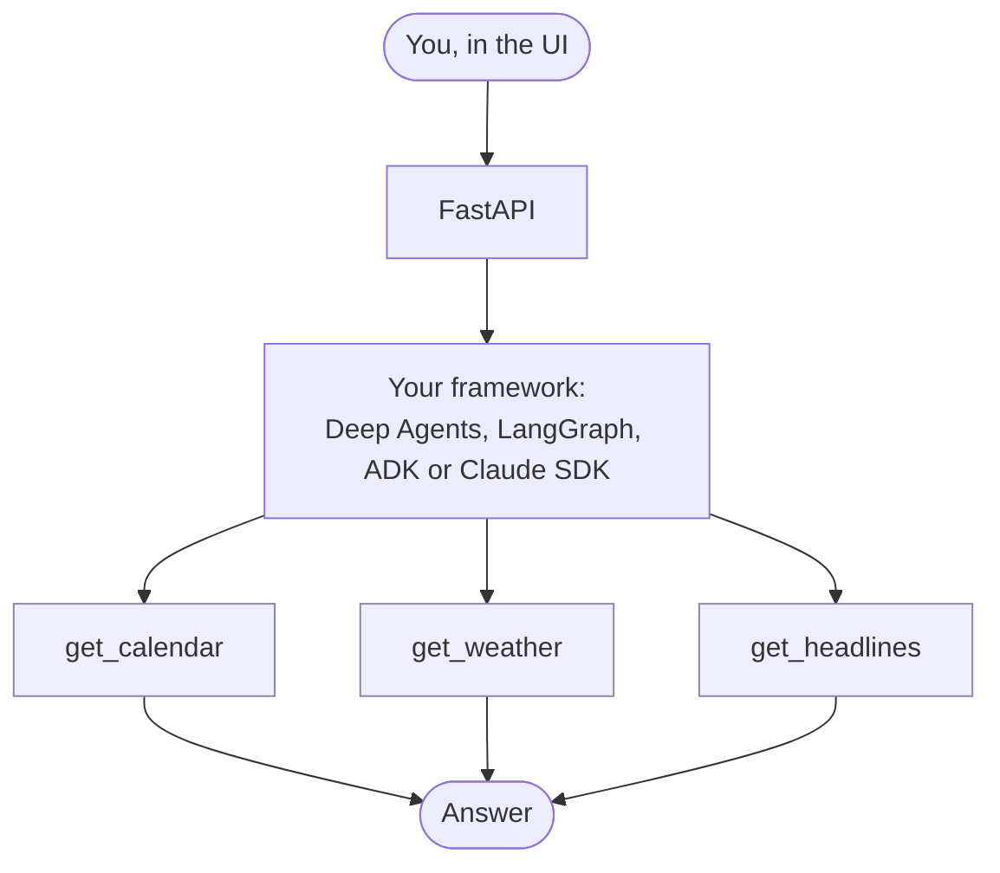

# 001. Morning brief

**Area:** Mornings and daily planning  
**Features:** parallel calls, uses preferences

Calendar, weather and news in parallel, shaped by your city and topics.

## What you ask

> Give me my morning brief.

## Flow



## Tools

| Tool | Effect | Control |
|---|---|---|
| `get_calendar`: Events for a day. | read-only | - |
| `get_weather`: Weather for a city. | read-only | - |
| `get_headlines`: Top headlines for topics. | read-only | - |

## Preferences it uses

| Preference | Default |
|---|---|
| `home_city` | Chicago |
| `name` | Sam Rivera |
| `news_topics` | AI, climate, Chicago |

## Run it

```bash
python usecases/001_morning_brief/usecase.py                 # your preferred framework
python usecases/001_morning_brief/usecase.py --all           # all four frameworks
python usecases/001_morning_brief/usecase.py --manual        # answer the approvals yourself
python usecases/001_morning_brief/usecase.py --framework adk --live   # Gemini decides (needs GOOGLE_API_KEY)
```

Or start the app (`uvicorn app.api:app`), open http://localhost:8000 and pick it from the list.
