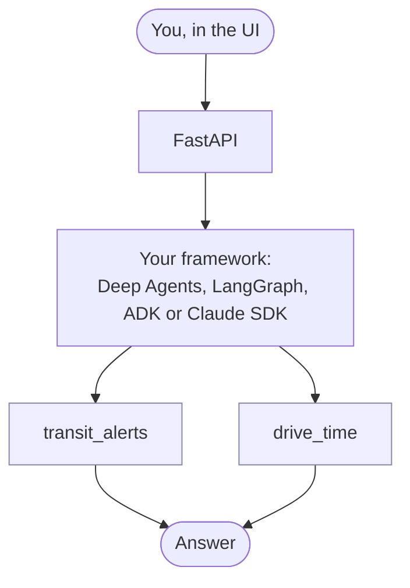

# 002. Commute check

**Area:** Mornings and daily planning  
**Features:** parallel calls, uses preferences

Checks transit alerts and traffic and picks the faster option.

## What you ask

> How's my commute looking?

## Flow



## Tools

| Tool | Effect | Control |
|---|---|---|
| `transit_alerts`: Transit alerts for a line. | read-only | - |
| `drive_time`: Driving time from home to work. | read-only | - |

## Preferences it uses

| Preference | Default |
|---|---|
| `home_city` | Chicago |

## Run it

```bash
python usecases/002_commute_check/usecase.py                 # your preferred framework
python usecases/002_commute_check/usecase.py --all           # all four frameworks
python usecases/002_commute_check/usecase.py --manual        # answer the approvals yourself
python usecases/002_commute_check/usecase.py --framework adk --live   # Gemini decides (needs GOOGLE_API_KEY)
```

Or start the app (`uvicorn app.api:app`), open http://localhost:8000 and pick it from the list.
