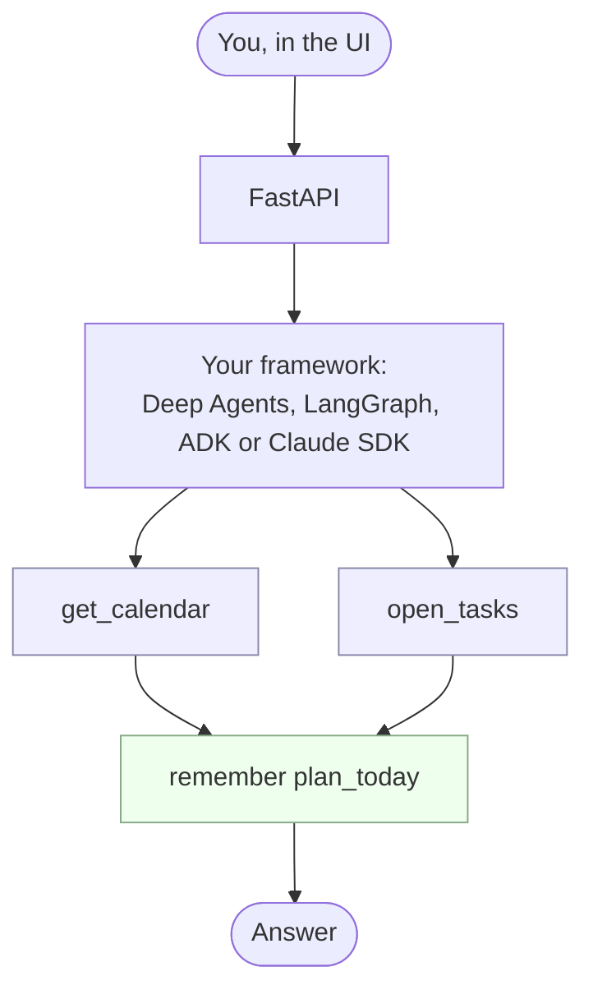

# 003. Plan my day from my task list

**Area:** Mornings and daily planning  
**Features:** parallel calls, memory, uses preferences

Fits open tasks into calendar gaps inside your work hours, and saves the plan.

## What you ask

> Plan my day around my meetings.

## Flow



## Tools

| Tool | Effect | Control |
|---|---|---|
| `get_calendar`: Events for a day. | read-only | - |
| `open_tasks`: Open tasks with estimates. | read-only | - |

## Preferences it uses

| Preference | Default |
|---|---|
| `work_hours` | 09:00-17:30 |

## Run it

```bash
python usecases/003_day_plan_from_tasks/usecase.py                 # your preferred framework
python usecases/003_day_plan_from_tasks/usecase.py --all           # all four frameworks
python usecases/003_day_plan_from_tasks/usecase.py --manual        # answer the approvals yourself
python usecases/003_day_plan_from_tasks/usecase.py --framework adk --live   # Gemini decides (needs GOOGLE_API_KEY)
```

Or start the app (`uvicorn app.api:app`), open http://localhost:8000 and pick it from the list.
