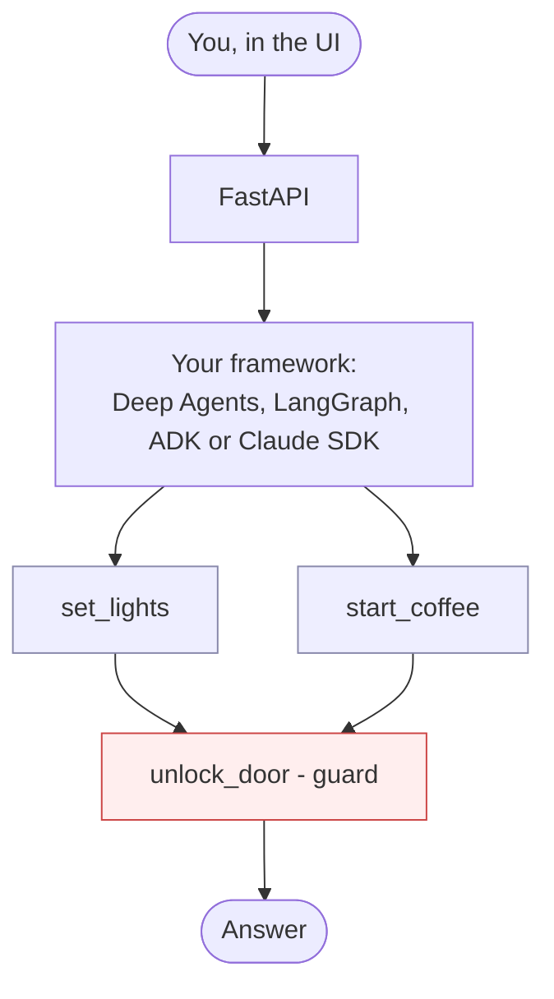

# 004. Wake-up routine

**Area:** Mornings and daily planning  
**Features:** parallel calls, guard

Turns on the lights and coffee. Unlocking the front door is blocked by a guard, whatever the model decides.

## What you ask

> Run my wake-up routine.

## Flow



## Tools

| Tool | Effect | Control |
|---|---|---|
| `set_lights`: Set lights in a room. | changes your data | - |
| `start_coffee`: Start the coffee machine. | changes your data | - |
| `unlock_door`: Unlock a door. | changes your data | guard |

## Guards

Checked in the shared tool layer before the tool runs, the same on every framework. Guards get your preferences, so changing a limit in the UI changes what's allowed.

- `unlock_door`

## Run it

```bash
python usecases/004_wake_up_routine/usecase.py                 # your preferred framework
python usecases/004_wake_up_routine/usecase.py --all           # all four frameworks
python usecases/004_wake_up_routine/usecase.py --manual        # answer the approvals yourself
python usecases/004_wake_up_routine/usecase.py --framework adk --live   # Gemini decides (needs GOOGLE_API_KEY)
```

Or start the app (`uvicorn app.api:app`), open http://localhost:8000 and pick it from the list.
