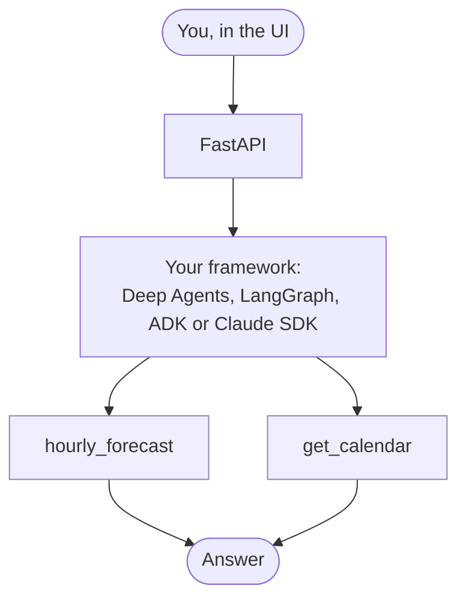

# 005. What should I wear

**Area:** Mornings and daily planning  
**Features:** parallel calls, uses preferences

Combines the forecast with what's on your calendar.

## What you ask

> What should I wear today?

## Flow



## Tools

| Tool | Effect | Control |
|---|---|---|
| `hourly_forecast`: Hourly forecast. | read-only | - |
| `get_calendar`: Events for a day. | read-only | - |

## Preferences it uses

| Preference | Default |
|---|---|
| `home_city` | Chicago |

## Run it

```bash
python usecases/005_what_to_wear/usecase.py                 # your preferred framework
python usecases/005_what_to_wear/usecase.py --all           # all four frameworks
python usecases/005_what_to_wear/usecase.py --manual        # answer the approvals yourself
python usecases/005_what_to_wear/usecase.py --framework adk --live   # Gemini decides (needs GOOGLE_API_KEY)
```

Or start the app (`uvicorn app.api:app`), open http://localhost:8000 and pick it from the list.
