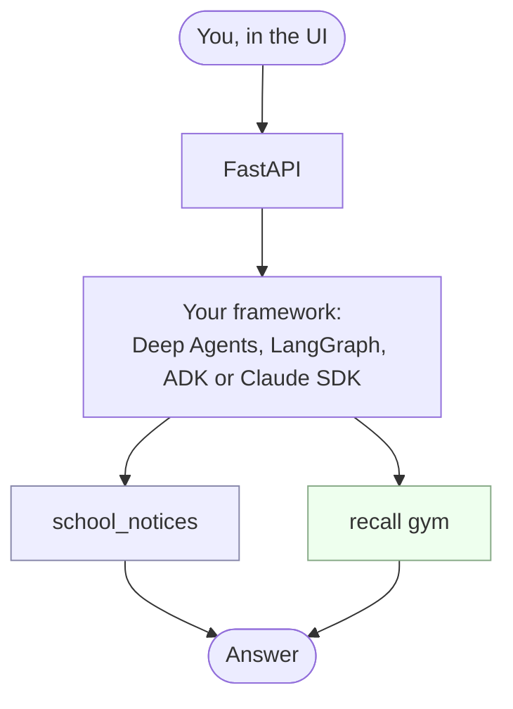

# 006. School run check

**Area:** Mornings and daily planning  
**Features:** parallel calls, memory, uses preferences

Reads the school portal and your memory of what she needs on gym days.

## What you ask

> Anything I need for Maya's school today?

## Flow



## Tools

| Tool | Effect | Control |
|---|---|---|
| `school_notices`: Notices from the school portal. | read-only | - |

## Preferences it uses

| Preference | Default |
|---|---|
| `kid` | Maya |

## Run it

```bash
python usecases/006_school_run_check/usecase.py                 # your preferred framework
python usecases/006_school_run_check/usecase.py --all           # all four frameworks
python usecases/006_school_run_check/usecase.py --manual        # answer the approvals yourself
python usecases/006_school_run_check/usecase.py --framework adk --live   # Gemini decides (needs GOOGLE_API_KEY)
```

Or start the app (`uvicorn app.api:app`), open http://localhost:8000 and pick it from the list.
