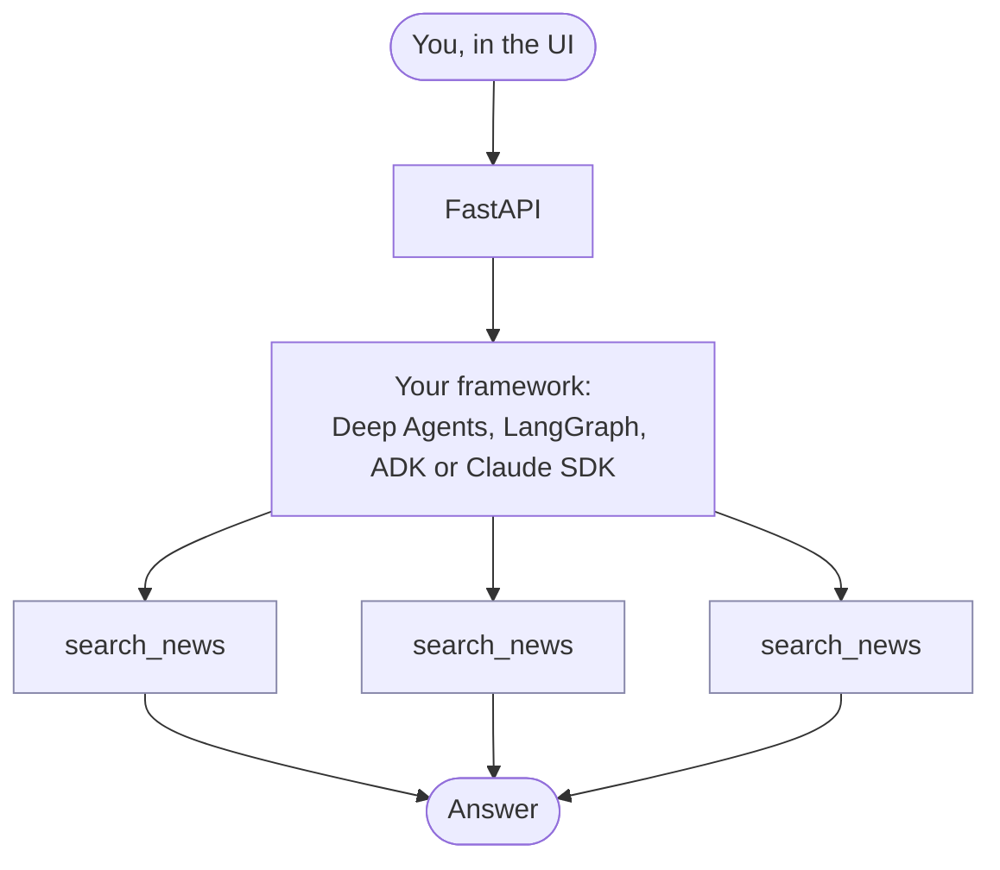

# 007. News digest on my topics

**Area:** Mornings and daily planning  
**Features:** parallel calls, uses preferences

Pulls each topic in parallel. Change news_topics in your preferences and the digest changes with it.

## What you ask

> Summarize the news for my topics.

## Flow



## Tools

| Tool | Effect | Control |
|---|---|---|
| `search_news`: Latest news for a query. | read-only | - |

## Preferences it uses

| Preference | Default |
|---|---|
| `home_city` | Chicago |

## Run it

```bash
python usecases/007_news_digest_by_topic/usecase.py                 # your preferred framework
python usecases/007_news_digest_by_topic/usecase.py --all           # all four frameworks
python usecases/007_news_digest_by_topic/usecase.py --manual        # answer the approvals yourself
python usecases/007_news_digest_by_topic/usecase.py --framework adk --live   # Gemini decides (needs GOOGLE_API_KEY)
```

Or start the app (`uvicorn app.api:app`), open http://localhost:8000 and pick it from the list.
