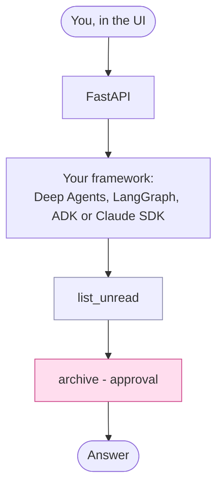

# 008. Overnight inbox triage

**Area:** Mornings and daily planning  
**Features:** approval

Sorts mail into reply / read / archive and archives newsletters after one approval.

## What you ask

> Triage my overnight email.

## Flow



## Tools

| Tool | Effect | Control |
|---|---|---|
| `list_unread`: Unread emails. | read-only | - |
| `archive`: Archive emails by id. | changes your data | approval |

## Approvals

In the UI the run pauses and you decide. With auto-approve (demo), these decisions are used:

- `archive`: approve

## Run it

```bash
python usecases/008_inbox_zero_triage/usecase.py                 # your preferred framework
python usecases/008_inbox_zero_triage/usecase.py --all           # all four frameworks
python usecases/008_inbox_zero_triage/usecase.py --manual        # answer the approvals yourself
python usecases/008_inbox_zero_triage/usecase.py --framework adk --live   # Gemini decides (needs GOOGLE_API_KEY)
```

Or start the app (`uvicorn app.api:app`), open http://localhost:8000 and pick it from the list.
