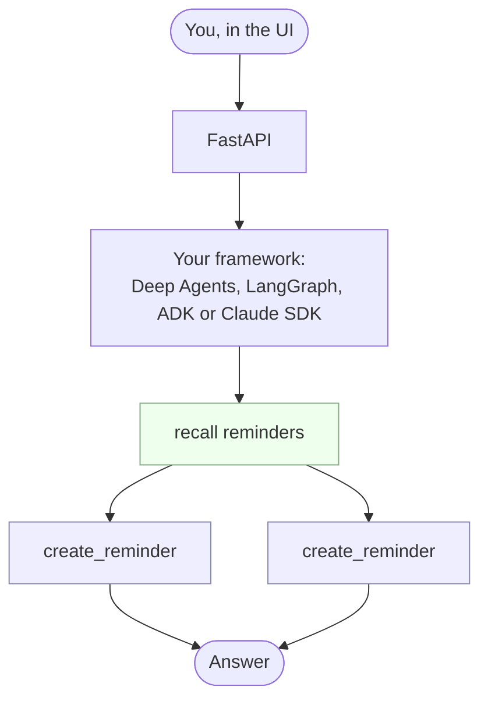

# 009. Daily reminders setup

**Area:** Mornings and daily planning  
**Features:** parallel calls, memory, uses preferences

Recreates reminders from memory, so you don't retype them on a new phone.

## What you ask

> Set my usual daily reminders.

## Flow



## Tools

| Tool | Effect | Control |
|---|---|---|
| `create_reminder`: Create a recurring reminder. | changes your data | - |

## Preferences it uses

| Preference | Default |
|---|---|
| `dog` | Biscuit |

## Run it

```bash
python usecases/009_medication_reminder_setup/usecase.py                 # your preferred framework
python usecases/009_medication_reminder_setup/usecase.py --all           # all four frameworks
python usecases/009_medication_reminder_setup/usecase.py --manual        # answer the approvals yourself
python usecases/009_medication_reminder_setup/usecase.py --framework adk --live   # Gemini decides (needs GOOGLE_API_KEY)
```

Or start the app (`uvicorn app.api:app`), open http://localhost:8000 and pick it from the list.
