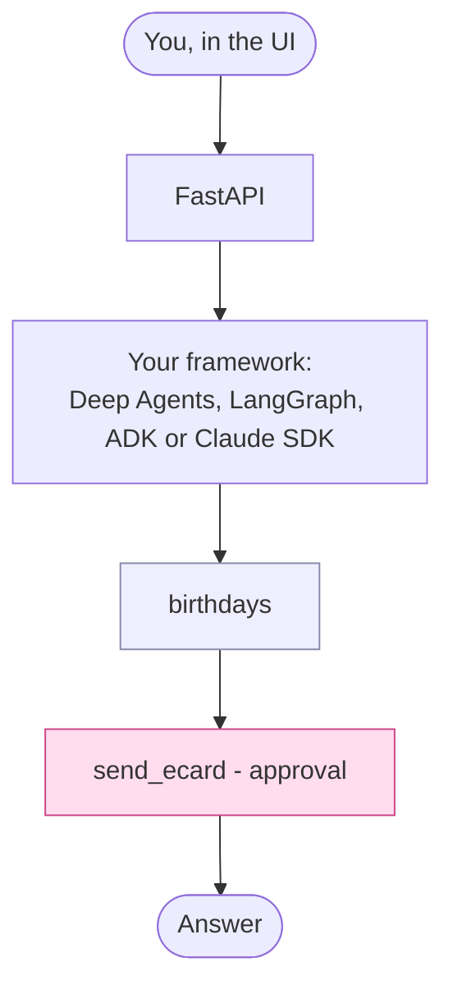

# 010. Birthdays coming up

**Area:** Mornings and daily planning  
**Features:** approval

Checks contacts and offers a card. Sending one is a real purchase, so it needs approval.

## What you ask

> Any birthdays this week?

## Flow



## Tools

| Tool | Effect | Control |
|---|---|---|
| `birthdays`: Contacts with birthdays in N days. | read-only | - |
| `send_ecard`: Send an e-card. | talks to someone else | approval |

## Approvals

In the UI the run pauses and you decide. With auto-approve (demo), these decisions are used:

- `send_ecard`: approve with edits `message="Happy birthday Tia Rosa! Can't wait to see you at Thanksgiving."`

## Run it

```bash
python usecases/010_birthday_check/usecase.py                 # your preferred framework
python usecases/010_birthday_check/usecase.py --all           # all four frameworks
python usecases/010_birthday_check/usecase.py --manual        # answer the approvals yourself
python usecases/010_birthday_check/usecase.py --framework adk --live   # Gemini decides (needs GOOGLE_API_KEY)
```

Or start the app (`uvicorn app.api:app`), open http://localhost:8000 and pick it from the list.
