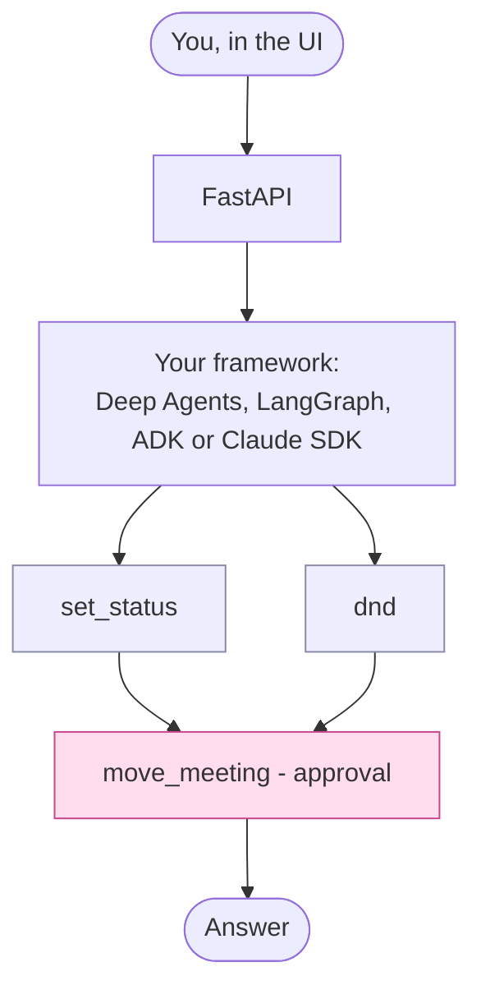

# 011. Focus mode until noon

**Area:** Mornings and daily planning  
**Features:** parallel calls, approval

Sets your Slack status and do-not-disturb, then moves one meeting after you approve.

## What you ask

> Turn on focus mode until noon.

## Flow



## Tools

| Tool | Effect | Control |
|---|---|---|
| `set_status`: Set chat status. | changes your data | - |
| `dnd`: Do not disturb until a time. | changes your data | - |
| `move_meeting`: Move a meeting. | talks to someone else | approval |

## Approvals

In the UI the run pauses and you decide. With auto-approve (demo), these decisions are used:

- `move_meeting`: approve

## Run it

```bash
python usecases/011_focus_mode/usecase.py                 # your preferred framework
python usecases/011_focus_mode/usecase.py --all           # all four frameworks
python usecases/011_focus_mode/usecase.py --manual        # answer the approvals yourself
python usecases/011_focus_mode/usecase.py --framework adk --live   # Gemini decides (needs GOOGLE_API_KEY)
```

Or start the app (`uvicorn app.api:app`), open http://localhost:8000 and pick it from the list.
