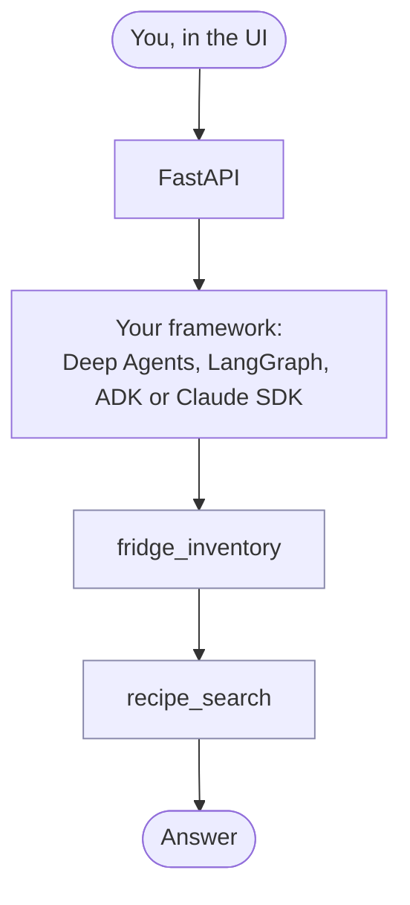

# 012. Breakfast from what's in the fridge

**Area:** Mornings and daily planning  
**Features:** uses preferences

Uses the fridge inventory and your diet preference.

## What you ask

> What can I make for breakfast?

## Flow



## Tools

| Tool | Effect | Control |
|---|---|---|
| `fridge_inventory`: What's in the fridge. | read-only | - |
| `recipe_search`: Recipes from ingredients. | read-only | - |

## Preferences it uses

| Preference | Default |
|---|---|
| `diet` | vegetarian |

## Run it

```bash
python usecases/012_breakfast_idea/usecase.py                 # your preferred framework
python usecases/012_breakfast_idea/usecase.py --all           # all four frameworks
python usecases/012_breakfast_idea/usecase.py --manual        # answer the approvals yourself
python usecases/012_breakfast_idea/usecase.py --framework adk --live   # Gemini decides (needs GOOGLE_API_KEY)
```

Or start the app (`uvicorn app.api:app`), open http://localhost:8000 and pick it from the list.
