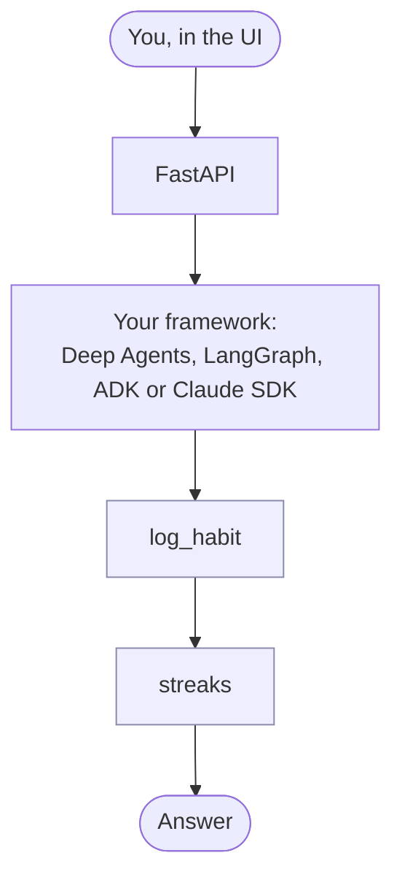

# 014. Habit tracker check-in

**Area:** Mornings and daily planning  
**Features:** tools only

Writes to the habit log and reads the streaks back.

## What you ask

> Log that I meditated and show my streaks.

## Flow



## Tools

| Tool | Effect | Control |
|---|---|---|
| `log_habit`: Log a habit for today. | changes your data | - |
| `streaks`: Current habit streaks. | read-only | - |

## Run it

```bash
python usecases/014_habit_streak/usecase.py                 # your preferred framework
python usecases/014_habit_streak/usecase.py --all           # all four frameworks
python usecases/014_habit_streak/usecase.py --manual        # answer the approvals yourself
python usecases/014_habit_streak/usecase.py --framework adk --live   # Gemini decides (needs GOOGLE_API_KEY)
```

Or start the app (`uvicorn app.api:app`), open http://localhost:8000 and pick it from the list.
