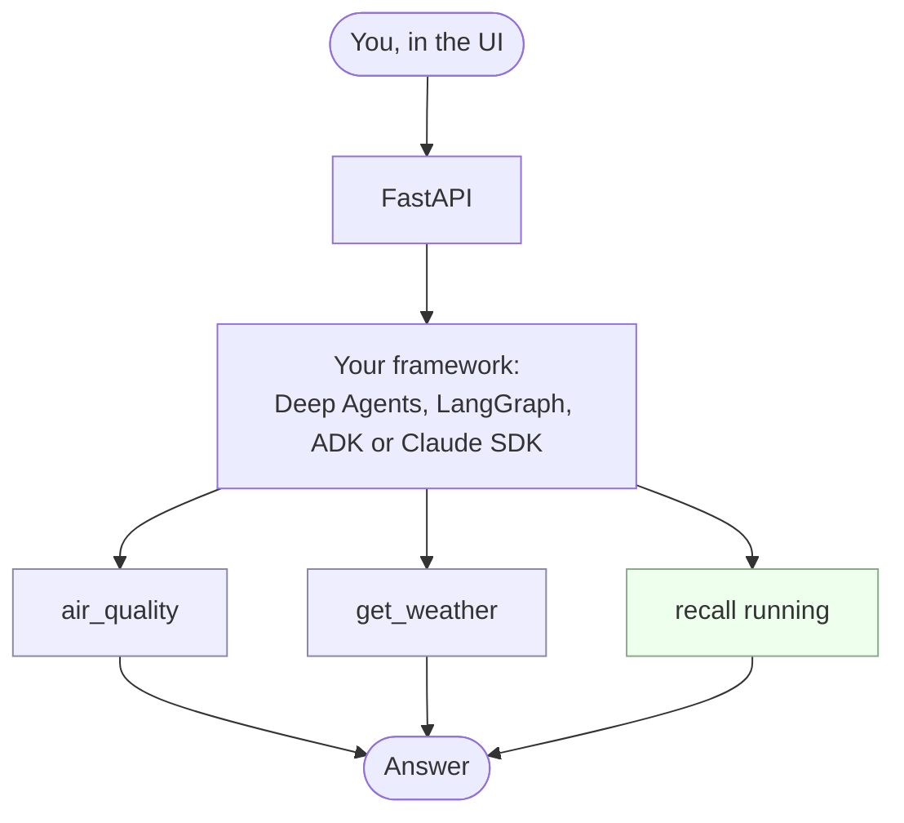

# 016. Is it OK to run outside

**Area:** Mornings and daily planning  
**Features:** parallel calls, memory, uses preferences

Air quality and weather together, plus your saved running preferences.

## What you ask

> Can I run outside this morning?

## Flow



## Tools

| Tool | Effect | Control |
|---|---|---|
| `air_quality`: AQI for a city. | read-only | - |
| `get_weather`: Weather for a city. | read-only | - |

## Preferences it uses

| Preference | Default |
|---|---|
| `home_city` | Chicago |

## Run it

```bash
python usecases/016_air_quality_run/usecase.py                 # your preferred framework
python usecases/016_air_quality_run/usecase.py --all           # all four frameworks
python usecases/016_air_quality_run/usecase.py --manual        # answer the approvals yourself
python usecases/016_air_quality_run/usecase.py --framework adk --live   # Gemini decides (needs GOOGLE_API_KEY)
```

Or start the app (`uvicorn app.api:app`), open http://localhost:8000 and pick it from the list.
