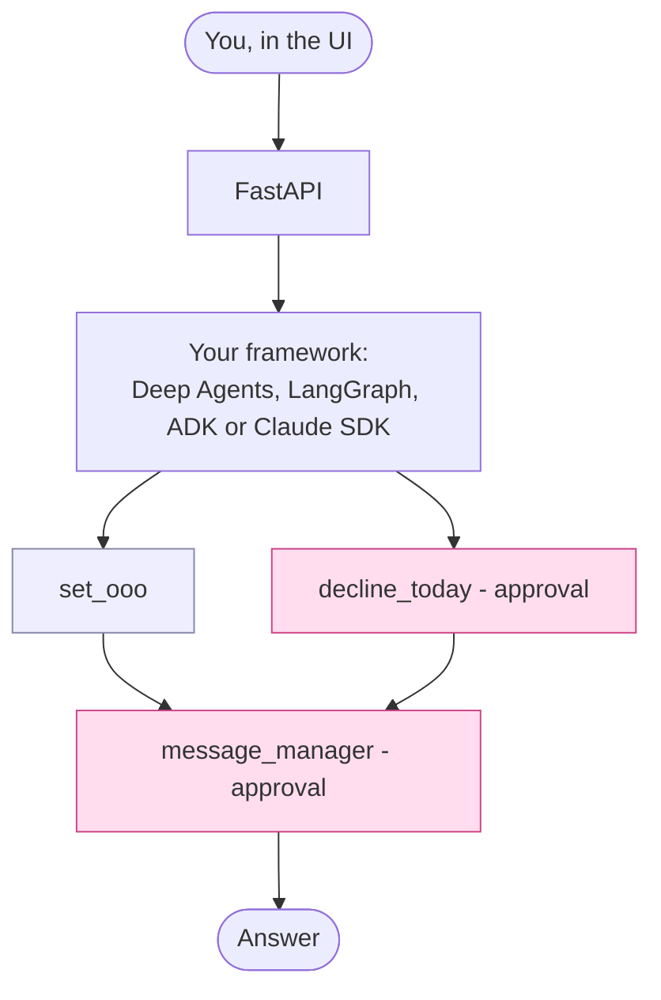

# 017. Out-of-office for a sick day

**Area:** Mornings and daily planning  
**Features:** parallel calls, approval

Sets the auto-reply, declines today's meetings, and messages your manager. The message waits for your edit.

## What you ask

> I'm out sick today. Handle it.

## Flow



## Tools

| Tool | Effect | Control |
|---|---|---|
| `set_ooo`: Set an email auto-reply. | changes your data | - |
| `decline_today`: Decline today's meetings. | talks to someone else | approval |
| `message_manager`: Message your manager. | talks to someone else | approval |

## Approvals

In the UI the run pauses and you decide. With auto-approve (demo), these decisions are used:

- `decline_today`: approve
- `message_manager`: approve with edits `text='Out sick today. The report draft is on track for Thursday; Jo can cover standup.'`

## Run it

```bash
python usecases/017_set_out_of_office/usecase.py                 # your preferred framework
python usecases/017_set_out_of_office/usecase.py --all           # all four frameworks
python usecases/017_set_out_of_office/usecase.py --manual        # answer the approvals yourself
python usecases/017_set_out_of_office/usecase.py --framework adk --live   # Gemini decides (needs GOOGLE_API_KEY)
```

Or start the app (`uvicorn app.api:app`), open http://localhost:8000 and pick it from the list.
