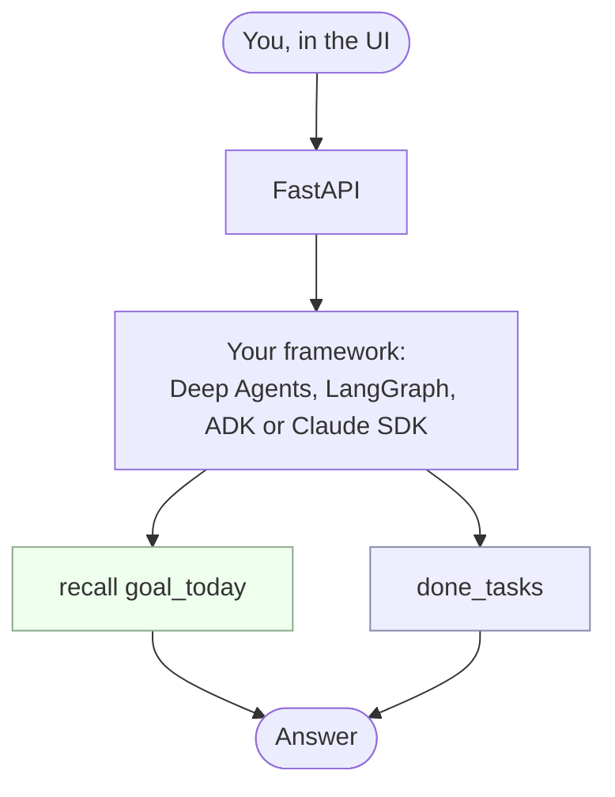

# 019. Evening review

**Area:** Mornings and daily planning  
**Features:** parallel calls, memory

Reads this morning's goal from memory and compares it with what you actually finished.

## What you ask

> Do my evening review.

## Flow



## Tools

| Tool | Effect | Control |
|---|---|---|
| `done_tasks`: Tasks completed today. | read-only | - |

## Run it

```bash
python usecases/019_evening_review/usecase.py                 # your preferred framework
python usecases/019_evening_review/usecase.py --all           # all four frameworks
python usecases/019_evening_review/usecase.py --manual        # answer the approvals yourself
python usecases/019_evening_review/usecase.py --framework adk --live   # Gemini decides (needs GOOGLE_API_KEY)
```

Or start the app (`uvicorn app.api:app`), open http://localhost:8000 and pick it from the list.
