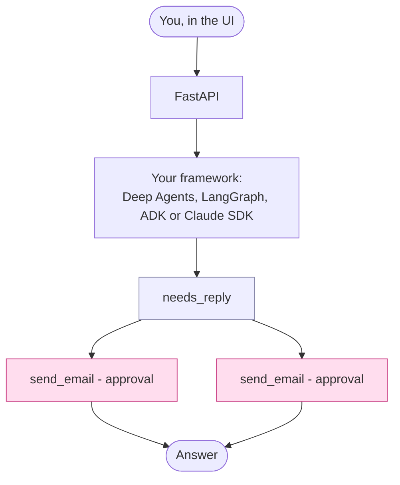

# 021. Draft replies to important email

**Area:** Email, messages and calendar  
**Features:** parallel calls, approval

Drafts only. Nothing is sent without your OK, and one draft gets edited first.

## What you ask

> Draft replies to the emails that need me.

## Flow



## Tools

| Tool | Effect | Control |
|---|---|---|
| `needs_reply`: Emails waiting on you. | read-only | - |
| `send_email`: Send an email reply. | talks to someone else | approval |

## Approvals

In the UI the run pauses and you decide. With auto-approve (demo), these decisions are used:

- `send_email`: call 1: approve with edits `body='Happy to renew, but could we talk about the 6% increase first?'`; call 2: approve

## Run it

```bash
python usecases/021_reply_drafts/usecase.py                 # your preferred framework
python usecases/021_reply_drafts/usecase.py --all           # all four frameworks
python usecases/021_reply_drafts/usecase.py --manual        # answer the approvals yourself
python usecases/021_reply_drafts/usecase.py --framework adk --live   # Gemini decides (needs GOOGLE_API_KEY)
```

Or start the app (`uvicorn app.api:app`), open http://localhost:8000 and pick it from the list.
