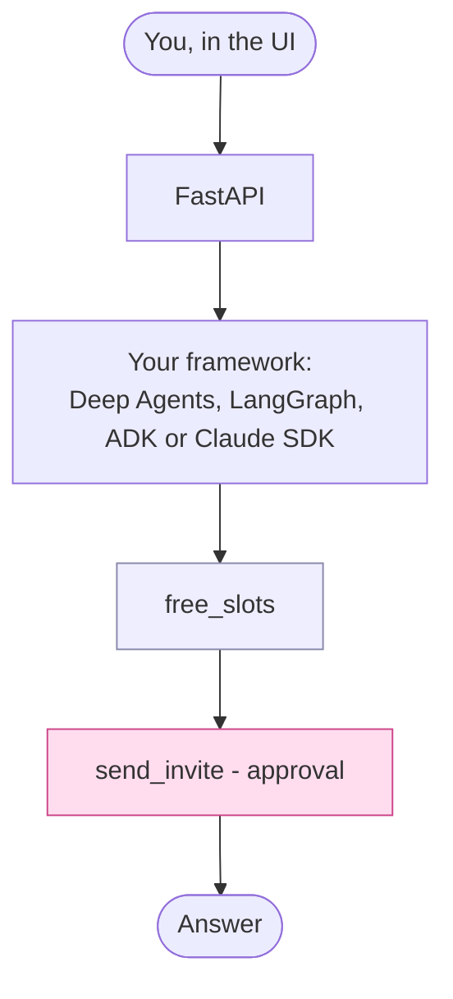

# 022. Find a time and book a meeting

**Area:** Email, messages and calendar  
**Features:** approval

Finds shared free time in your work hours. The invite waits for approval.

## What you ask

> Book an hour with Priya and Tom next week.

## Flow



## Tools

| Tool | Effect | Control |
|---|---|---|
| `free_slots`: Shared free slots. | read-only | - |
| `send_invite`: Send a calendar invite. | talks to someone else | approval |

## Approvals

In the UI the run pauses and you decide. With auto-approve (demo), these decisions are used:

- `send_invite`: approve

## Run it

```bash
python usecases/022_schedule_meeting/usecase.py                 # your preferred framework
python usecases/022_schedule_meeting/usecase.py --all           # all four frameworks
python usecases/022_schedule_meeting/usecase.py --manual        # answer the approvals yourself
python usecases/022_schedule_meeting/usecase.py --framework adk --live   # Gemini decides (needs GOOGLE_API_KEY)
```

Or start the app (`uvicorn app.api:app`), open http://localhost:8000 and pick it from the list.
