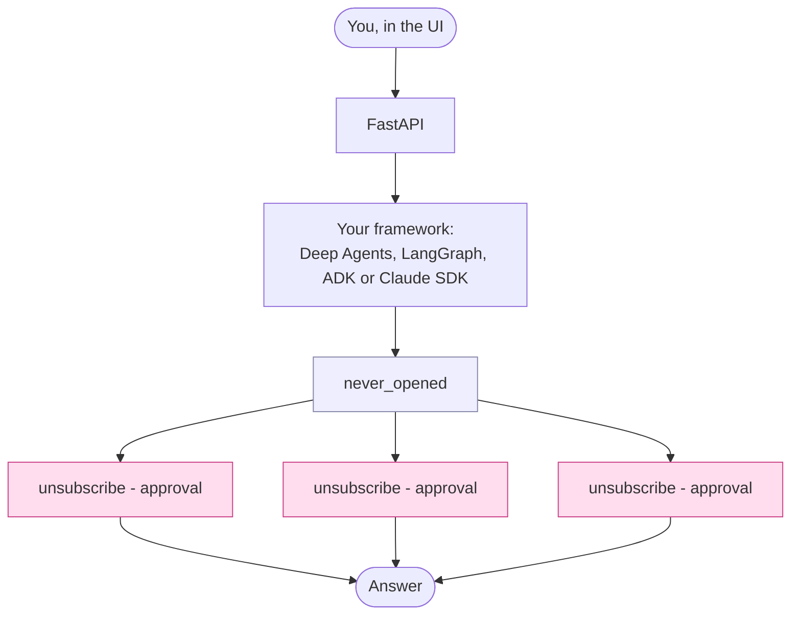

# 023. Unsubscribe from junk

**Area:** Email, messages and calendar  
**Features:** parallel calls, approval

Uses open-rate data. You reject one unsubscribe you want to keep.

## What you ask

> Unsubscribe me from newsletters I never open.

## Flow



## Tools

| Tool | Effect | Control |
|---|---|---|
| `never_opened`: Senders you haven't opened in 90 days. | read-only | - |
| `unsubscribe`: Unsubscribe from a sender. | talks to someone else | approval |

## Approvals

In the UI the run pauses and you decide. With auto-approve (demo), these decisions are used:

- `unsubscribe`: call 1: approve; call 2: approve; call 3: reject

## Run it

```bash
python usecases/023_unsubscribe_cleanup/usecase.py                 # your preferred framework
python usecases/023_unsubscribe_cleanup/usecase.py --all           # all four frameworks
python usecases/023_unsubscribe_cleanup/usecase.py --manual        # answer the approvals yourself
python usecases/023_unsubscribe_cleanup/usecase.py --framework adk --live   # Gemini decides (needs GOOGLE_API_KEY)
```

Or start the app (`uvicorn app.api:app`), open http://localhost:8000 and pick it from the list.
