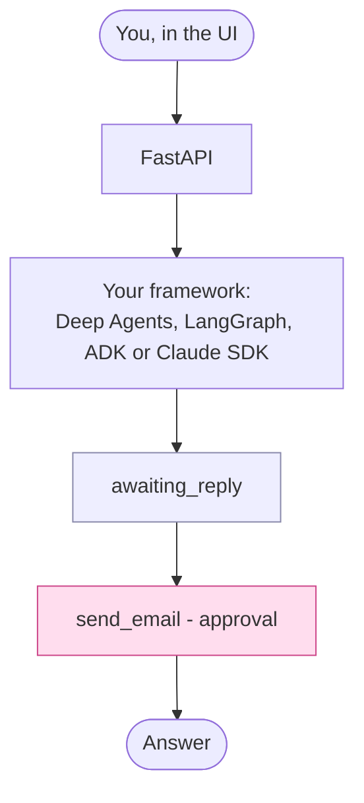

# 025. Follow-ups I'm waiting on

**Area:** Email, messages and calendar  
**Features:** approval

Finds sent emails with no answer and sends polite nudges after approval.

## What you ask

> Who hasn't replied to me this week?

## Flow



## Tools

| Tool | Effect | Control |
|---|---|---|
| `awaiting_reply`: Sent emails with no reply. | read-only | - |
| `send_email`: Send an email. | talks to someone else | approval |

## Approvals

In the UI the run pauses and you decide. With auto-approve (demo), these decisions are used:

- `send_email`: approve

## Run it

```bash
python usecases/025_follow_up_nudges/usecase.py                 # your preferred framework
python usecases/025_follow_up_nudges/usecase.py --all           # all four frameworks
python usecases/025_follow_up_nudges/usecase.py --manual        # answer the approvals yourself
python usecases/025_follow_up_nudges/usecase.py --framework adk --live   # Gemini decides (needs GOOGLE_API_KEY)
```

Or start the app (`uvicorn app.api:app`), open http://localhost:8000 and pick it from the list.
