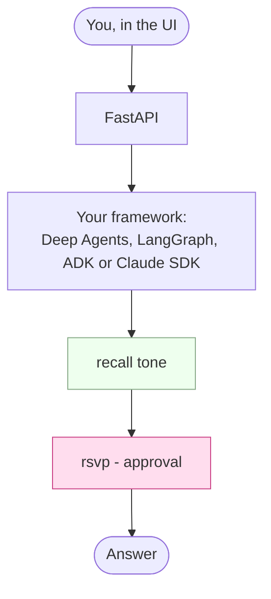

# 027. Decline a meeting politely

**Area:** Email, messages and calendar  
**Features:** approval, memory

Uses your saved tone preference from memory.

## What you ask

> Decline Friday's optional all-hands and say why.

## Flow



## Tools

| Tool | Effect | Control |
|---|---|---|
| `rsvp`: RSVP to an event. | talks to someone else | approval |

## Approvals

In the UI the run pauses and you decide. With auto-approve (demo), these decisions are used:

- `rsvp`: approve

## Run it

```bash
python usecases/027_decline_politely/usecase.py                 # your preferred framework
python usecases/027_decline_politely/usecase.py --all           # all four frameworks
python usecases/027_decline_politely/usecase.py --manual        # answer the approvals yourself
python usecases/027_decline_politely/usecase.py --framework adk --live   # Gemini decides (needs GOOGLE_API_KEY)
```

Or start the app (`uvicorn app.api:app`), open http://localhost:8000 and pick it from the list.
