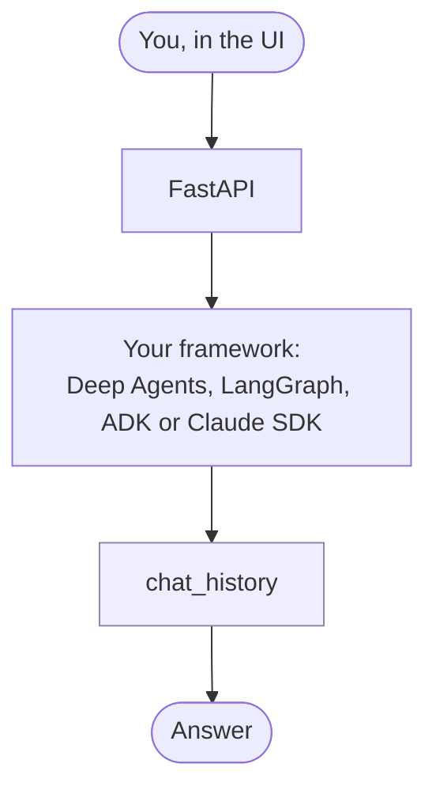

# 028. Catch up on the family group chat

**Area:** Email, messages and calendar  
**Features:** tools only

Summarizes 140 messages into what you actually need to know.

## What you ask

> What did I miss in the family chat?

## Flow



## Tools

| Tool | Effect | Control |
|---|---|---|
| `chat_history`: Messages from a chat. | read-only | - |

## Run it

```bash
python usecases/028_group_chat_catchup/usecase.py                 # your preferred framework
python usecases/028_group_chat_catchup/usecase.py --all           # all four frameworks
python usecases/028_group_chat_catchup/usecase.py --manual        # answer the approvals yourself
python usecases/028_group_chat_catchup/usecase.py --framework adk --live   # Gemini decides (needs GOOGLE_API_KEY)
```

Or start the app (`uvicorn app.api:app`), open http://localhost:8000 and pick it from the list.
