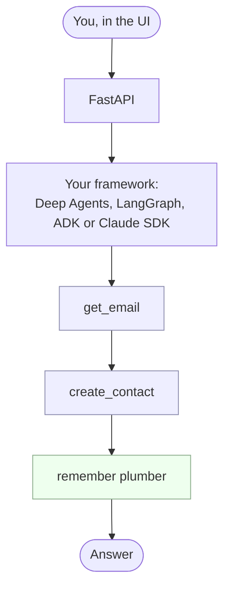

# 029. Save a new contact from an email

**Area:** Email, messages and calendar  
**Features:** memory

Extracts details from the email signature and creates the contact.

## What you ask

> Save the plumber from that email as a contact.

## Flow



## Tools

| Tool | Effect | Control |
|---|---|---|
| `get_email`: Get an email. | read-only | - |
| `create_contact`: Create a contact. | changes your data | - |

## Run it

```bash
python usecases/029_save_contact_details/usecase.py                 # your preferred framework
python usecases/029_save_contact_details/usecase.py --all           # all four frameworks
python usecases/029_save_contact_details/usecase.py --manual        # answer the approvals yourself
python usecases/029_save_contact_details/usecase.py --framework adk --live   # Gemini decides (needs GOOGLE_API_KEY)
```

Or start the app (`uvicorn app.api:app`), open http://localhost:8000 and pick it from the list.
