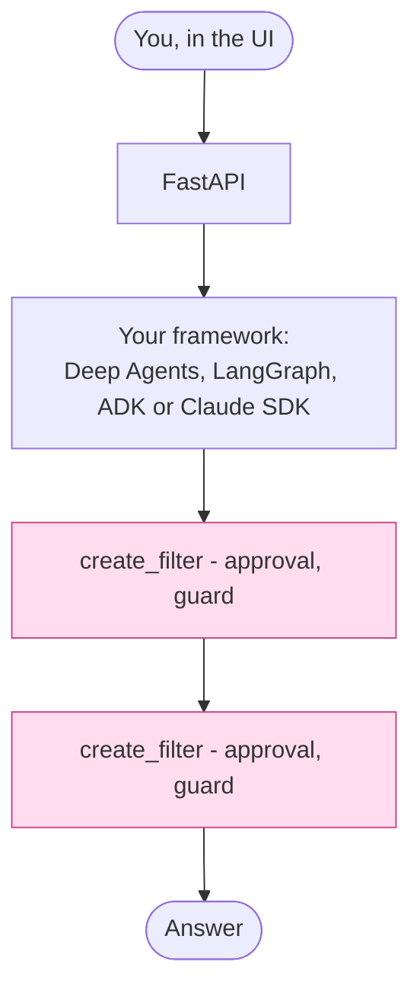

# 031. Make an email filter

**Area:** Email, messages and calendar  
**Features:** approval, guard

Creates the rule after approval. Rules that delete mail are blocked.

## What you ask

> Filter project-alerts into a folder.

## Flow



## Tools

| Tool | Effect | Control |
|---|---|---|
| `create_filter`: Create an email filter. | changes your data | approval, guard |

## Approvals

In the UI the run pauses and you decide. With auto-approve (demo), these decisions are used:

- `create_filter`: approve

## Guards

Checked in the shared tool layer before the tool runs, the same on every framework. Guards get your preferences, so changing a limit in the UI changes what's allowed.

- `create_filter`

## Run it

```bash
python usecases/031_create_email_filter/usecase.py                 # your preferred framework
python usecases/031_create_email_filter/usecase.py --all           # all four frameworks
python usecases/031_create_email_filter/usecase.py --manual        # answer the approvals yourself
python usecases/031_create_email_filter/usecase.py --framework adk --live   # Gemini decides (needs GOOGLE_API_KEY)
```

Or start the app (`uvicorn app.api:app`), open http://localhost:8000 and pick it from the list.
