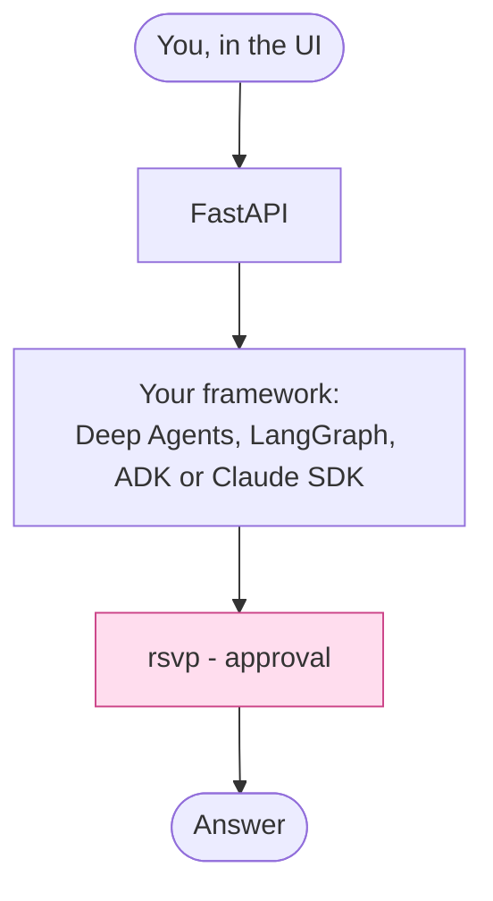

# 032. RSVP to a party

**Area:** Email, messages and calendar  
**Features:** approval, uses preferences

Simple, but it's a message to someone else, so it waits for approval.

## What you ask

> RSVP yes to the Chens' party for me and Jordan.

## Flow



## Tools

| Tool | Effect | Control |
|---|---|---|
| `rsvp`: RSVP to an invite. | talks to someone else | approval |

## Approvals

In the UI the run pauses and you decide. With auto-approve (demo), these decisions are used:

- `rsvp`: approve

## Preferences it uses

| Preference | Default |
|---|---|
| `partner` | Jordan |

## Run it

```bash
python usecases/032_rsvp_party/usecase.py                 # your preferred framework
python usecases/032_rsvp_party/usecase.py --all           # all four frameworks
python usecases/032_rsvp_party/usecase.py --manual        # answer the approvals yourself
python usecases/032_rsvp_party/usecase.py --framework adk --live   # Gemini decides (needs GOOGLE_API_KEY)
```

Or start the app (`uvicorn app.api:app`), open http://localhost:8000 and pick it from the list.
