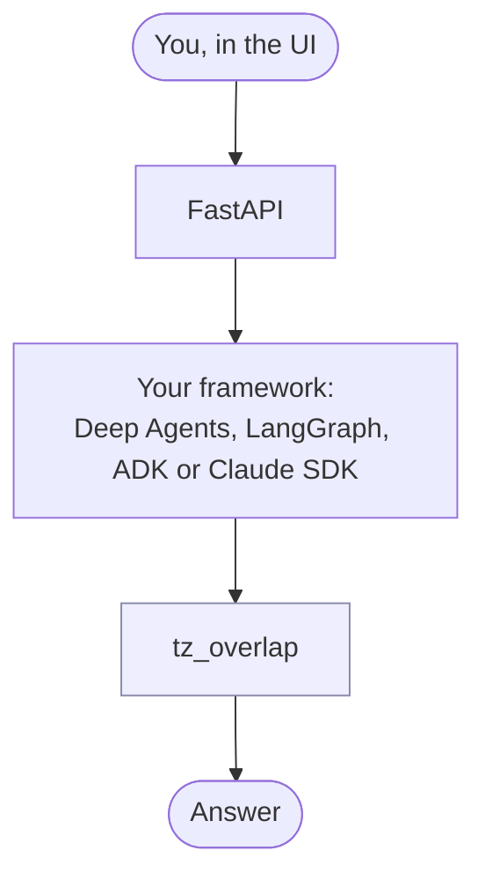

# 033. Meeting across time zones

**Area:** Email, messages and calendar  
**Features:** uses preferences

Checks both time zones and suggests sane hours for both of you.

## What you ask

> Find a time for a call with my cousin in Madrid.

## Flow



## Tools

| Tool | Effect | Control |
|---|---|---|
| `tz_overlap`: Overlap of waking hours. | read-only | - |

## Preferences it uses

| Preference | Default |
|---|---|
| `timezone` | America/Chicago |

## Run it

```bash
python usecases/033_time_zone_meeting/usecase.py                 # your preferred framework
python usecases/033_time_zone_meeting/usecase.py --all           # all four frameworks
python usecases/033_time_zone_meeting/usecase.py --manual        # answer the approvals yourself
python usecases/033_time_zone_meeting/usecase.py --framework adk --live   # Gemini decides (needs GOOGLE_API_KEY)
```

Or start the app (`uvicorn app.api:app`), open http://localhost:8000 and pick it from the list.
