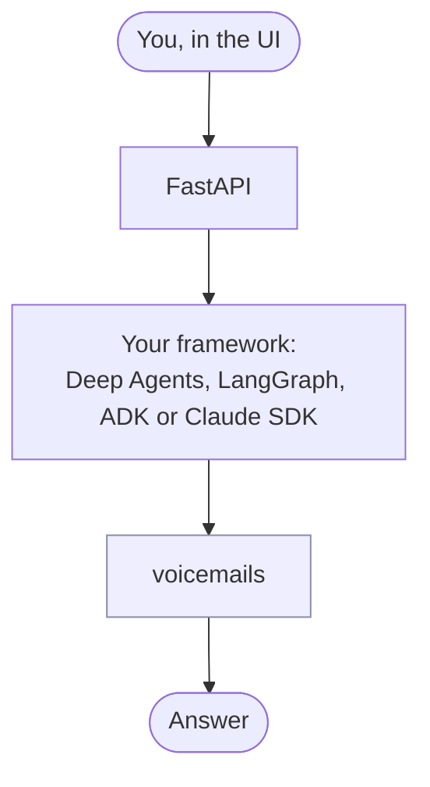

# 034. Voicemails to text

**Area:** Email, messages and calendar  
**Features:** tools only

Transcribes them and flags the one that needs a call back.

## What you ask

> What are my voicemails about?

## Flow



## Tools

| Tool | Effect | Control |
|---|---|---|
| `voicemails`: Transcribed voicemails. | read-only | - |

## Run it

```bash
python usecases/034_voicemail_transcribe/usecase.py                 # your preferred framework
python usecases/034_voicemail_transcribe/usecase.py --all           # all four frameworks
python usecases/034_voicemail_transcribe/usecase.py --manual        # answer the approvals yourself
python usecases/034_voicemail_transcribe/usecase.py --framework adk --live   # Gemini decides (needs GOOGLE_API_KEY)
```

Or start the app (`uvicorn app.api:app`), open http://localhost:8000 and pick it from the list.
