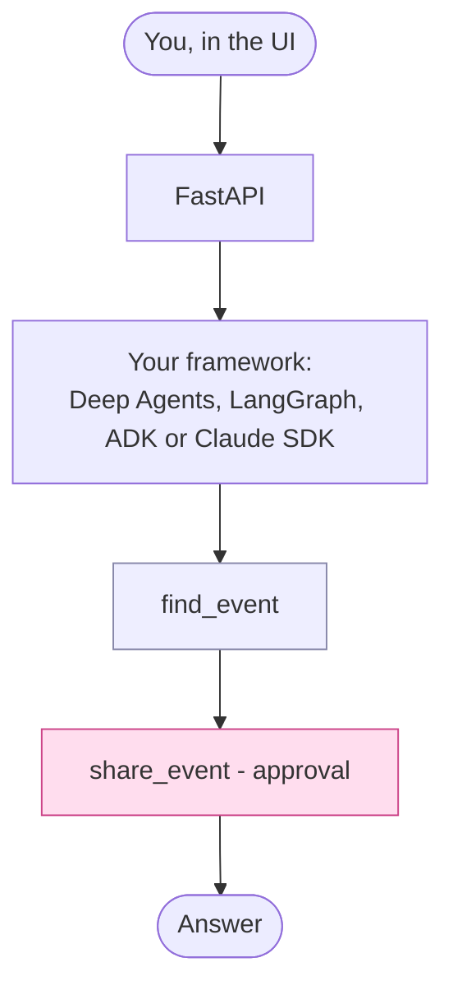

# 035. Share an event with family

**Area:** Email, messages and calendar  
**Features:** approval, uses preferences

Copying events to someone else's calendar needs approval.

## What you ask

> Add Maya's recital to Jordan's calendar too.

## Flow



## Tools

| Tool | Effect | Control |
|---|---|---|
| `find_event`: Find an event. | read-only | - |
| `share_event`: Share an event with someone. | talks to someone else | approval |

## Approvals

In the UI the run pauses and you decide. With auto-approve (demo), these decisions are used:

- `share_event`: approve

## Preferences it uses

| Preference | Default |
|---|---|
| `kid` | Maya |
| `partner` | Jordan |

## Run it

```bash
python usecases/035_share_calendar_family/usecase.py                 # your preferred framework
python usecases/035_share_calendar_family/usecase.py --all           # all four frameworks
python usecases/035_share_calendar_family/usecase.py --manual        # answer the approvals yourself
python usecases/035_share_calendar_family/usecase.py --framework adk --live   # Gemini decides (needs GOOGLE_API_KEY)
```

Or start the app (`uvicorn app.api:app`), open http://localhost:8000 and pick it from the list.
