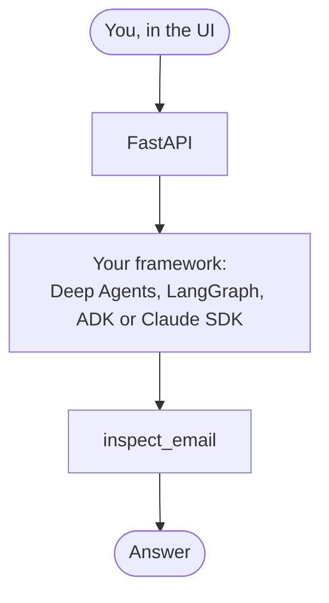

# 036. Is this email phishing?

**Area:** Email, messages and calendar  
**Features:** tools only

Checks the sender domain and links. It never clicks anything.

## What you ask

> Is the 'your account is locked' email real?

## Flow



## Tools

| Tool | Effect | Control |
|---|---|---|
| `inspect_email`: Headers and links of an email. | read-only | - |

## Run it

```bash
python usecases/036_phishing_check/usecase.py                 # your preferred framework
python usecases/036_phishing_check/usecase.py --all           # all four frameworks
python usecases/036_phishing_check/usecase.py --manual        # answer the approvals yourself
python usecases/036_phishing_check/usecase.py --framework adk --live   # Gemini decides (needs GOOGLE_API_KEY)
```

Or start the app (`uvicorn app.api:app`), open http://localhost:8000 and pick it from the list.
