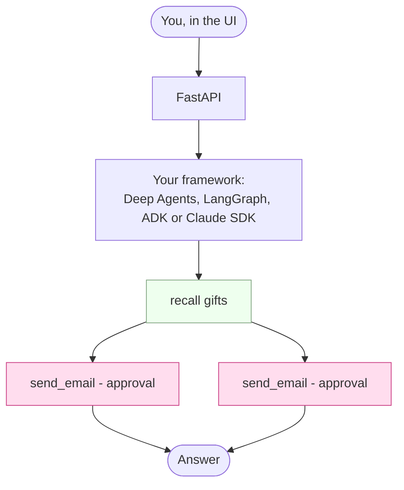

# 037. Thank-you notes after a party

**Area:** Email, messages and calendar  
**Features:** parallel calls, approval, memory

Reads the gift list you saved and sends the notes after one approval for the batch.

## What you ask

> Draft thank-you notes for Maya's birthday gifts.

## Flow



## Tools

| Tool | Effect | Control |
|---|---|---|
| `send_email`: Send an email. | talks to someone else | approval |

## Approvals

In the UI the run pauses and you decide. With auto-approve (demo), these decisions are used:

- `send_email`: approve

## Run it

```bash
python usecases/037_thank_you_notes/usecase.py                 # your preferred framework
python usecases/037_thank_you_notes/usecase.py --all           # all four frameworks
python usecases/037_thank_you_notes/usecase.py --manual        # answer the approvals yourself
python usecases/037_thank_you_notes/usecase.py --framework adk --live   # Gemini decides (needs GOOGLE_API_KEY)
```

Or start the app (`uvicorn app.api:app`), open http://localhost:8000 and pick it from the list.
