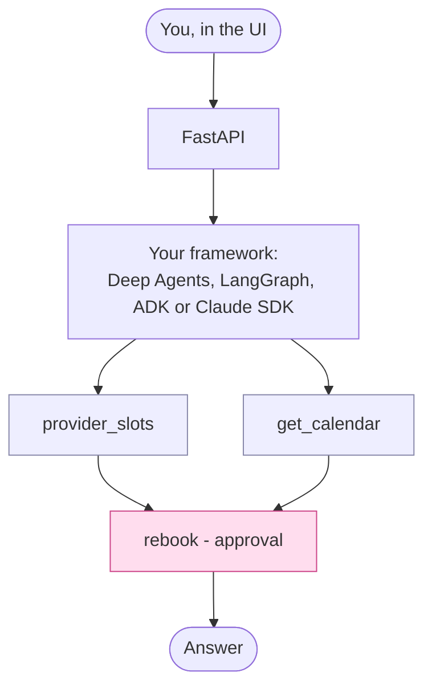

# 038. Reschedule an appointment

**Area:** Email, messages and calendar  
**Features:** parallel calls, approval

Checks open slots against your calendar, then books after approval.

## What you ask

> Move my dentist appointment to next week.

## Flow



## Tools

| Tool | Effect | Control |
|---|---|---|
| `provider_slots`: Open slots at a provider. | read-only | - |
| `get_calendar`: Events for a day. | read-only | - |
| `rebook`: Rebook an appointment. | talks to someone else | approval |

## Approvals

In the UI the run pauses and you decide. With auto-approve (demo), these decisions are used:

- `rebook`: approve

## Run it

```bash
python usecases/038_reschedule_dentist/usecase.py                 # your preferred framework
python usecases/038_reschedule_dentist/usecase.py --all           # all four frameworks
python usecases/038_reschedule_dentist/usecase.py --manual        # answer the approvals yourself
python usecases/038_reschedule_dentist/usecase.py --framework adk --live   # Gemini decides (needs GOOGLE_API_KEY)
```

Or start the app (`uvicorn app.api:app`), open http://localhost:8000 and pick it from the list.
