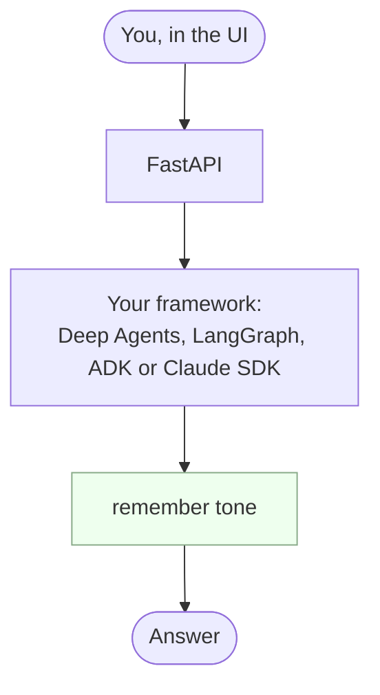

# 039. Remember how I like to reply

**Area:** Email, messages and calendar  
**Features:** memory

A standing preference, saved so every drafting task uses it.

## What you ask

> Remember: keep my replies short and sign off with just 'Sam'.

## Flow



## Tools

| Tool | Effect | Control |
|---|---|---|
| (only `remember` / `recall`) | memory | - |

## Run it

```bash
python usecases/039_auto_reply_rules/usecase.py                 # your preferred framework
python usecases/039_auto_reply_rules/usecase.py --all           # all four frameworks
python usecases/039_auto_reply_rules/usecase.py --manual        # answer the approvals yourself
python usecases/039_auto_reply_rules/usecase.py --framework adk --live   # Gemini decides (needs GOOGLE_API_KEY)
```

Or start the app (`uvicorn app.api:app`), open http://localhost:8000 and pick it from the list.
