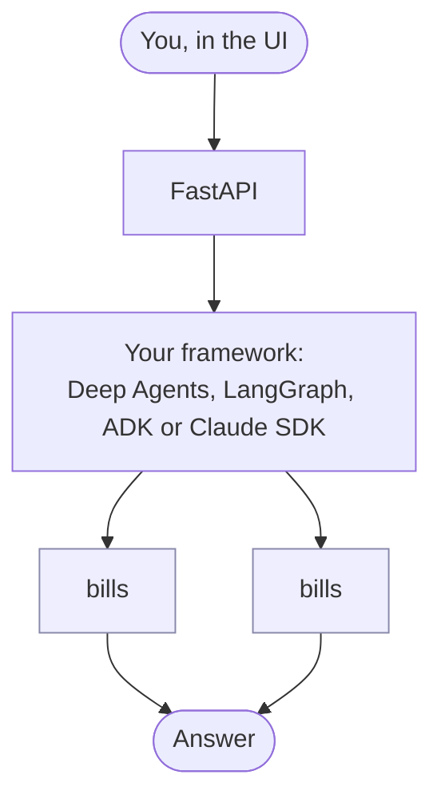

# 041. Bills due this week

**Area:** Bills, budget and money admin  
**Features:** parallel calls

Reads every account in parallel and lists what's due and from where.

## What you ask

> What bills are due this week?

## Flow



## Tools

| Tool | Effect | Control |
|---|---|---|
| `bills`: Upcoming bills for an account. | read-only | - |

## Run it

```bash
python usecases/041_bills_due_this_week/usecase.py                 # your preferred framework
python usecases/041_bills_due_this_week/usecase.py --all           # all four frameworks
python usecases/041_bills_due_this_week/usecase.py --manual        # answer the approvals yourself
python usecases/041_bills_due_this_week/usecase.py --framework adk --live   # Gemini decides (needs GOOGLE_API_KEY)
```

Or start the app (`uvicorn app.api:app`), open http://localhost:8000 and pick it from the list.
