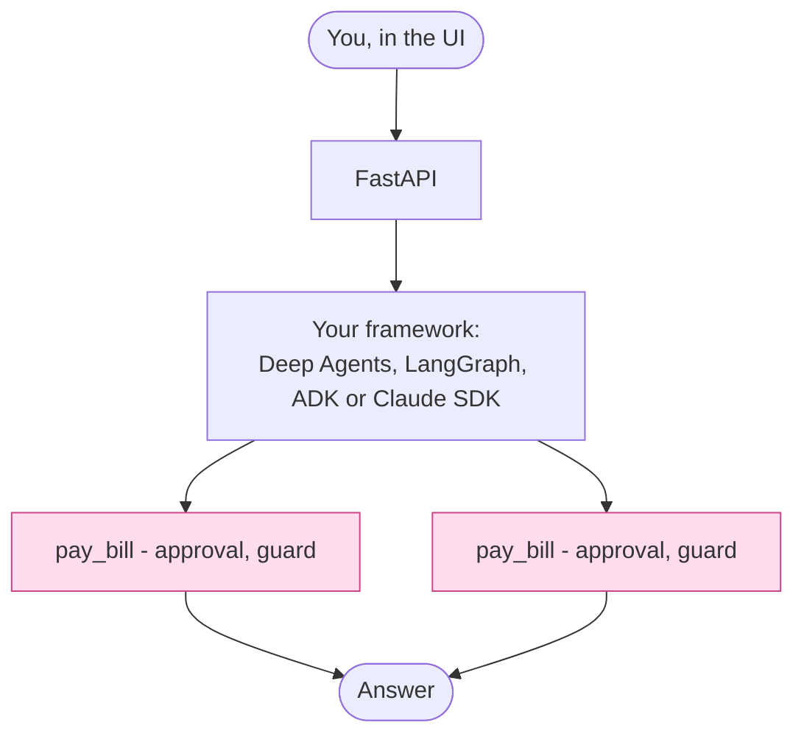

# 042. Pay a bill (with a spending limit)

**Area:** Bills, budget and money admin  
**Features:** parallel calls, approval, guard

Payments need approval, and anything over your max_purchase_without_review preference is blocked in code.

## What you ask

> Pay the electric bill and the Visa.

## Flow



## Tools

| Tool | Effect | Control |
|---|---|---|
| `pay_bill`: Pay a bill. | spends money | approval, guard |

## Approvals

In the UI the run pauses and you decide. With auto-approve (demo), these decisions are used:

- `pay_bill`: approve

## Guards

Checked in the shared tool layer before the tool runs, the same on every framework. Guards get your preferences, so changing a limit in the UI changes what's allowed.

- `pay_bill`

## Run it

```bash
python usecases/042_pay_bill_with_limit/usecase.py                 # your preferred framework
python usecases/042_pay_bill_with_limit/usecase.py --all           # all four frameworks
python usecases/042_pay_bill_with_limit/usecase.py --manual        # answer the approvals yourself
python usecases/042_pay_bill_with_limit/usecase.py --framework adk --live   # Gemini decides (needs GOOGLE_API_KEY)
```

Or start the app (`uvicorn app.api:app`), open http://localhost:8000 and pick it from the list.
