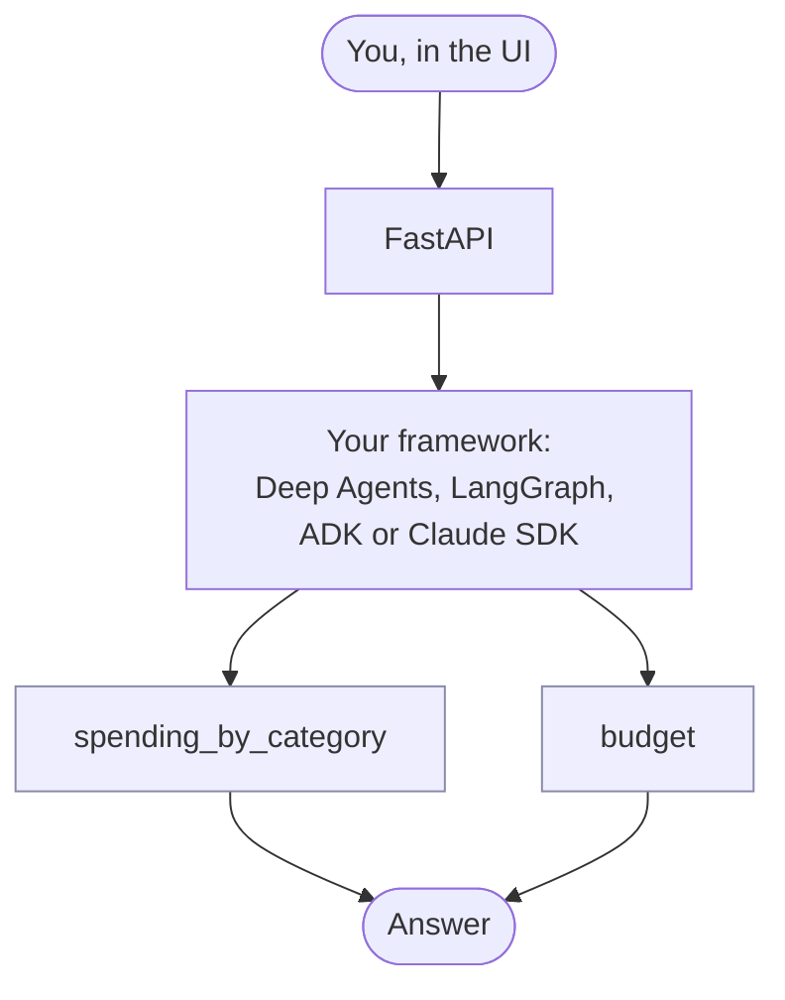

# 043. Monthly budget review

**Area:** Bills, budget and money admin  
**Features:** parallel calls

Compares spending by category with the budget you set.

## What you ask

> How did I do against my budget this month?

## Flow



## Tools

| Tool | Effect | Control |
|---|---|---|
| `spending_by_category`: Spending this month. | read-only | - |
| `budget`: Your budget. | read-only | - |

## Run it

```bash
python usecases/043_monthly_budget_review/usecase.py                 # your preferred framework
python usecases/043_monthly_budget_review/usecase.py --all           # all four frameworks
python usecases/043_monthly_budget_review/usecase.py --manual        # answer the approvals yourself
python usecases/043_monthly_budget_review/usecase.py --framework adk --live   # Gemini decides (needs GOOGLE_API_KEY)
```

Or start the app (`uvicorn app.api:app`), open http://localhost:8000 and pick it from the list.
