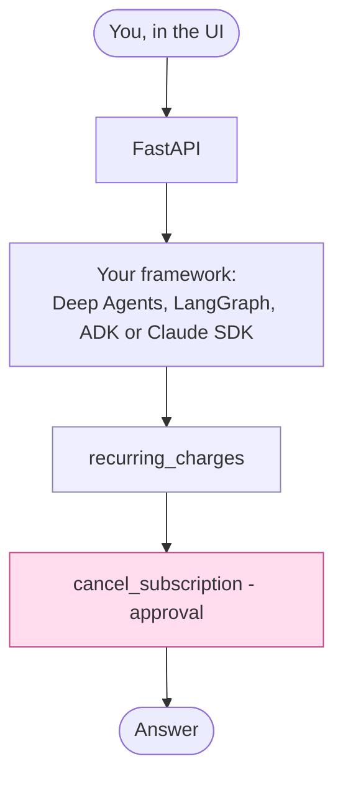

# 044. Subscription audit

**Area:** Bills, budget and money admin  
**Features:** approval

Finds recurring charges and cancels one after approval.

## What you ask

> What subscriptions am I paying for?

## Flow



## Tools

| Tool | Effect | Control |
|---|---|---|
| `recurring_charges`: Recurring charges. | read-only | - |
| `cancel_subscription`: Cancel a subscription. | talks to someone else | approval |

## Approvals

In the UI the run pauses and you decide. With auto-approve (demo), these decisions are used:

- `cancel_subscription`: approve

## Run it

```bash
python usecases/044_subscription_audit/usecase.py                 # your preferred framework
python usecases/044_subscription_audit/usecase.py --all           # all four frameworks
python usecases/044_subscription_audit/usecase.py --manual        # answer the approvals yourself
python usecases/044_subscription_audit/usecase.py --framework adk --live   # Gemini decides (needs GOOGLE_API_KEY)
```

Or start the app (`uvicorn app.api:app`), open http://localhost:8000 and pick it from the list.
