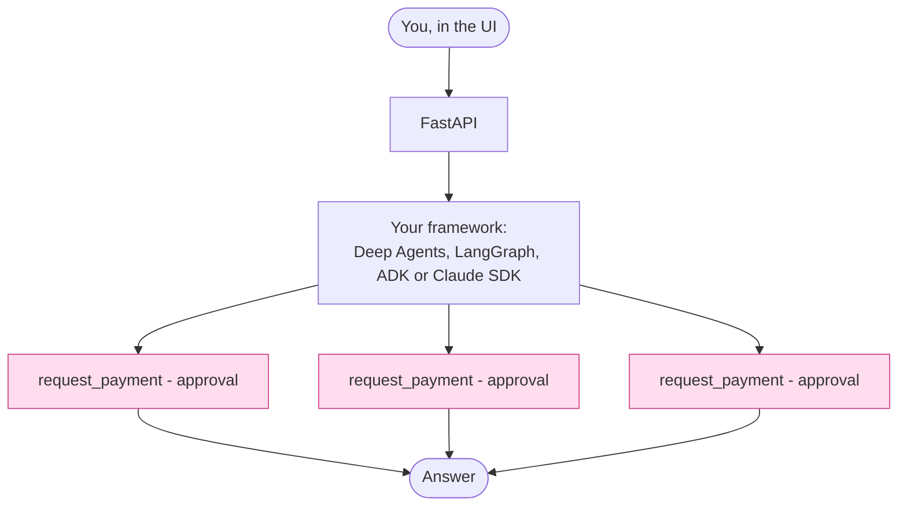

# 045. Split a dinner bill

**Area:** Bills, budget and money admin  
**Features:** parallel calls, approval

Calculates the split and sends payment requests after approval.

## What you ask

> Split last night's $186 dinner four ways and request payment.

## Flow



## Tools

| Tool | Effect | Control |
|---|---|---|
| `request_payment`: Send a payment request. | spends money | approval |

## Approvals

In the UI the run pauses and you decide. With auto-approve (demo), these decisions are used:

- `request_payment`: approve

## Run it

```bash
python usecases/045_split_dinner_bill/usecase.py                 # your preferred framework
python usecases/045_split_dinner_bill/usecase.py --all           # all four frameworks
python usecases/045_split_dinner_bill/usecase.py --manual        # answer the approvals yourself
python usecases/045_split_dinner_bill/usecase.py --framework adk --live   # Gemini decides (needs GOOGLE_API_KEY)
```

Or start the app (`uvicorn app.api:app`), open http://localhost:8000 and pick it from the list.
