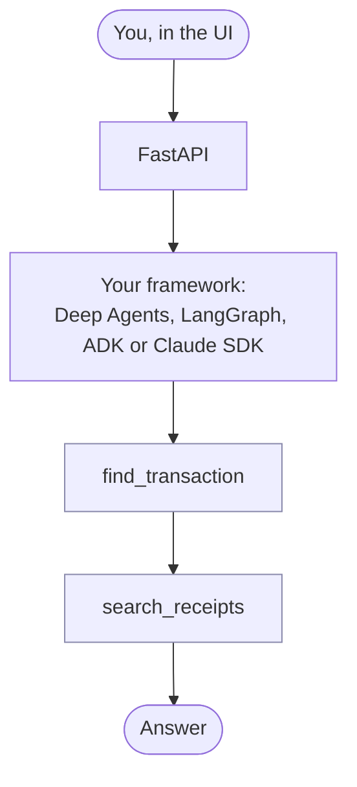

# 046. Check an unusual charge

**Area:** Bills, budget and money admin  
**Features:** tools only

Matches the charge against your calendar and email receipts.

## What you ask

> What's this $89 charge from 'SQ *BLUEDOOR'?

## Flow



## Tools

| Tool | Effect | Control |
|---|---|---|
| `find_transaction`: Find a card transaction. | read-only | - |
| `search_receipts`: Search email receipts. | read-only | - |

## Run it

```bash
python usecases/046_unusual_charge_check/usecase.py                 # your preferred framework
python usecases/046_unusual_charge_check/usecase.py --all           # all four frameworks
python usecases/046_unusual_charge_check/usecase.py --manual        # answer the approvals yourself
python usecases/046_unusual_charge_check/usecase.py --framework adk --live   # Gemini decides (needs GOOGLE_API_KEY)
```

Or start the app (`uvicorn app.api:app`), open http://localhost:8000 and pick it from the list.
