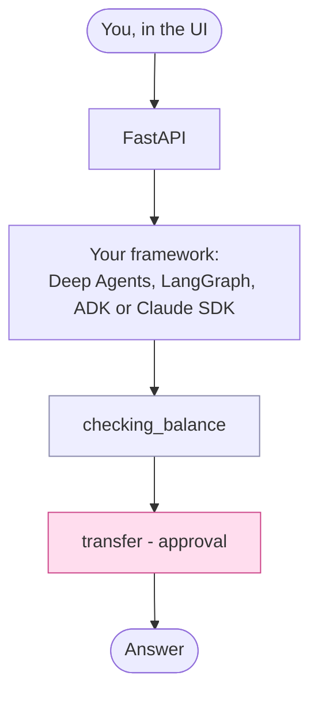

# 048. Move money to savings

**Area:** Bills, budget and money admin  
**Features:** approval

Transfers need approval. You edit it down to $300 before it runs.

## What you ask

> Move $500 to savings.

## Flow



## Tools

| Tool | Effect | Control |
|---|---|---|
| `checking_balance`: Checking balance. | read-only | - |
| `transfer`: Transfer between your accounts. | spends money | approval |

## Approvals

In the UI the run pauses and you decide. With auto-approve (demo), these decisions are used:

- `transfer`: approve with edits `amount=300.0`

## Run it

```bash
python usecases/048_move_money_to_savings/usecase.py                 # your preferred framework
python usecases/048_move_money_to_savings/usecase.py --all           # all four frameworks
python usecases/048_move_money_to_savings/usecase.py --manual        # answer the approvals yourself
python usecases/048_move_money_to_savings/usecase.py --framework adk --live   # Gemini decides (needs GOOGLE_API_KEY)
```

Or start the app (`uvicorn app.api:app`), open http://localhost:8000 and pick it from the list.
