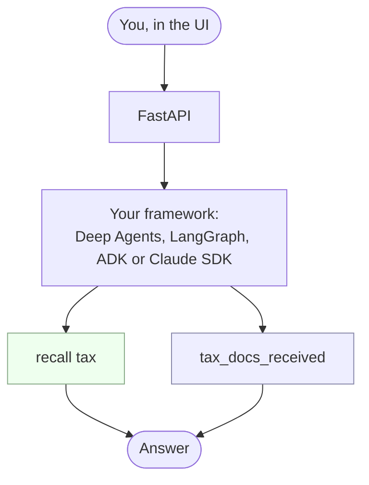

# 049. Tax documents checklist

**Area:** Bills, budget and money admin  
**Features:** parallel calls, memory

Compares what has arrived with last year's list from memory.

## What you ask

> Which tax documents do I still need?

## Flow



## Tools

| Tool | Effect | Control |
|---|---|---|
| `tax_docs_received`: Tax documents received so far. | read-only | - |

## Run it

```bash
python usecases/049_tax_documents_checklist/usecase.py                 # your preferred framework
python usecases/049_tax_documents_checklist/usecase.py --all           # all four frameworks
python usecases/049_tax_documents_checklist/usecase.py --manual        # answer the approvals yourself
python usecases/049_tax_documents_checklist/usecase.py --framework adk --live   # Gemini decides (needs GOOGLE_API_KEY)
```

Or start the app (`uvicorn app.api:app`), open http://localhost:8000 and pick it from the list.
