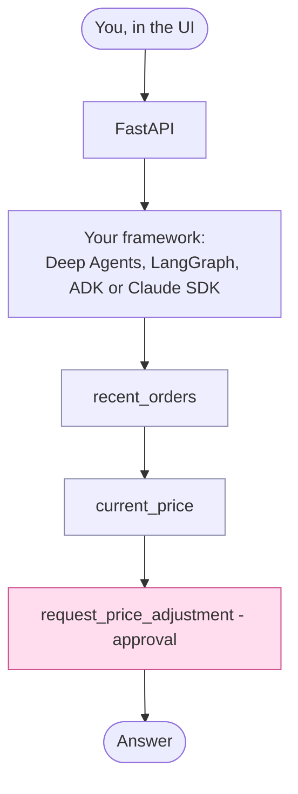

# 050. Price drop after I bought it

**Area:** Bills, budget and money admin  
**Features:** approval

Checks recent orders against current prices and files a price-adjustment request after approval.

## What you ask

> Did anything I bought recently drop in price?

## Flow



## Tools

| Tool | Effect | Control |
|---|---|---|
| `recent_orders`: Recent orders. | read-only | - |
| `current_price`: Current price of an item. | read-only | - |
| `request_price_adjustment`: Ask a store for a price adjustment. | talks to someone else | approval |

## Approvals

In the UI the run pauses and you decide. With auto-approve (demo), these decisions are used:

- `request_price_adjustment`: approve

## Run it

```bash
python usecases/050_price_drop_refund/usecase.py                 # your preferred framework
python usecases/050_price_drop_refund/usecase.py --all           # all four frameworks
python usecases/050_price_drop_refund/usecase.py --manual        # answer the approvals yourself
python usecases/050_price_drop_refund/usecase.py --framework adk --live   # Gemini decides (needs GOOGLE_API_KEY)
```

Or start the app (`uvicorn app.api:app`), open http://localhost:8000 and pick it from the list.
