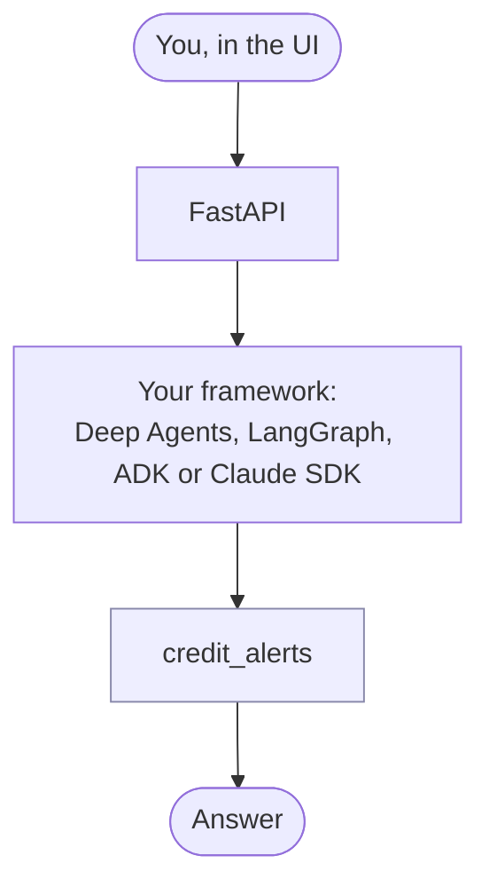

# 052. Credit report alerts

**Area:** Bills, budget and money admin  
**Features:** tools only

Reads monitoring alerts and points out anything unusual.

## What you ask

> Any changes on my credit report?

## Flow



## Tools

| Tool | Effect | Control |
|---|---|---|
| `credit_alerts`: Credit monitoring alerts. | read-only | - |

## Run it

```bash
python usecases/052_credit_score_check/usecase.py                 # your preferred framework
python usecases/052_credit_score_check/usecase.py --all           # all four frameworks
python usecases/052_credit_score_check/usecase.py --manual        # answer the approvals yourself
python usecases/052_credit_score_check/usecase.py --framework adk --live   # Gemini decides (needs GOOGLE_API_KEY)
```

Or start the app (`uvicorn app.api:app`), open http://localhost:8000 and pick it from the list.
