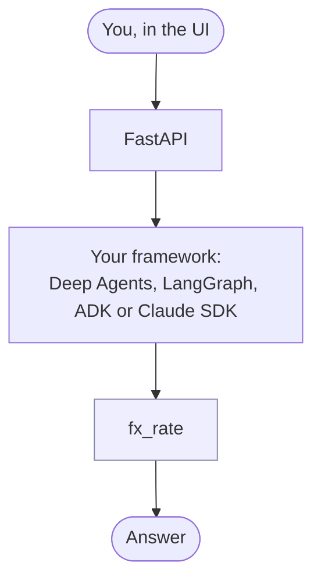

# 053. How much is that in dollars

**Area:** Bills, budget and money admin  
**Features:** uses preferences

Uses the live rate for your currency preference.

## What you ask

> Convert 250 euros for my trip budget.

## Flow



## Tools

| Tool | Effect | Control |
|---|---|---|
| `fx_rate`: Exchange rate. | read-only | - |

## Preferences it uses

| Preference | Default |
|---|---|
| `currency` | USD |

## Run it

```bash
python usecases/053_currency_for_trip/usecase.py                 # your preferred framework
python usecases/053_currency_for_trip/usecase.py --all           # all four frameworks
python usecases/053_currency_for_trip/usecase.py --manual        # answer the approvals yourself
python usecases/053_currency_for_trip/usecase.py --framework adk --live   # Gemini decides (needs GOOGLE_API_KEY)
```

Or start the app (`uvicorn app.api:app`), open http://localhost:8000 and pick it from the list.
