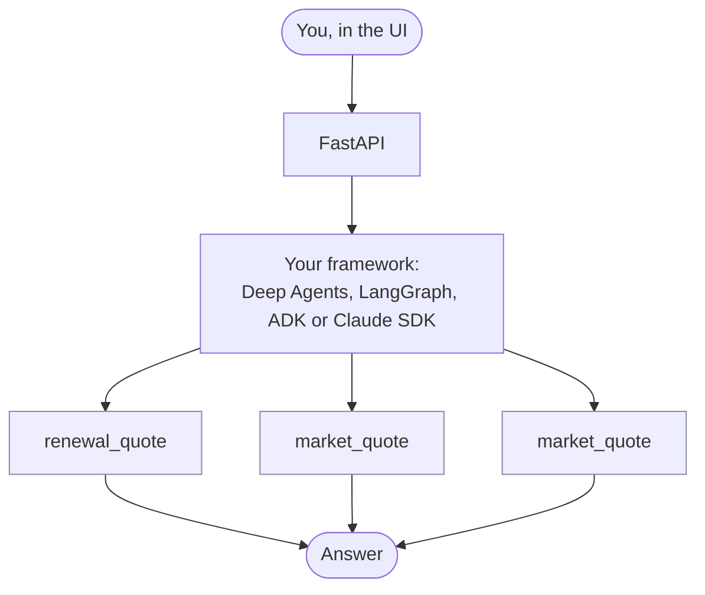

# 055. Compare insurance renewal quotes

**Area:** Bills, budget and money admin  
**Features:** parallel calls

Gets quotes in parallel and compares them with the renewal.

## What you ask

> My car insurance renews next month. Is it a good price?

## Flow



## Tools

| Tool | Effect | Control |
|---|---|---|
| `renewal_quote`: Current insurer's renewal. | read-only | - |
| `market_quote`: Quote from another insurer. | read-only | - |

## Run it

```bash
python usecases/055_insurance_renewal_compare/usecase.py                 # your preferred framework
python usecases/055_insurance_renewal_compare/usecase.py --all           # all four frameworks
python usecases/055_insurance_renewal_compare/usecase.py --manual        # answer the approvals yourself
python usecases/055_insurance_renewal_compare/usecase.py --framework adk --live   # Gemini decides (needs GOOGLE_API_KEY)
```

Or start the app (`uvicorn app.api:app`), open http://localhost:8000 and pick it from the list.
