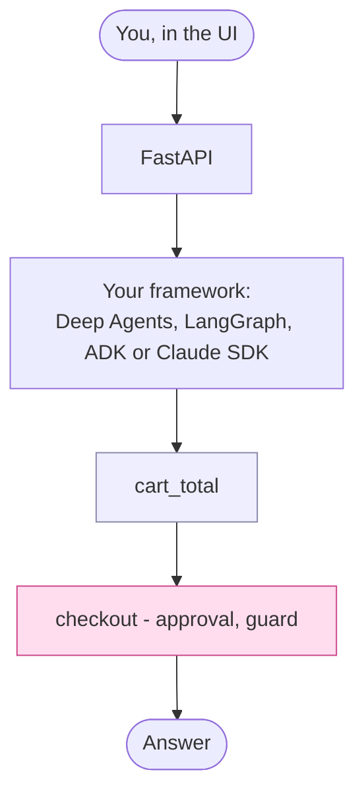

# 056. Buy a new laptop

**Area:** Bills, budget and money admin  
**Features:** approval, guard

An example of the guard: the agent tries, and your limit stops it.

## What you ask

> Buy the laptop in my cart.

## Flow



## Tools

| Tool | Effect | Control |
|---|---|---|
| `cart_total`: Cart total. | read-only | - |
| `checkout`: Place the order. | spends money | approval, guard |

## Approvals

In the UI the run pauses and you decide. With auto-approve (demo), these decisions are used:

- `checkout`: approve

## Guards

Checked in the shared tool layer before the tool runs, the same on every framework. Guards get your preferences, so changing a limit in the UI changes what's allowed.

- `checkout`

## Run it

```bash
python usecases/056_big_purchase_blocked/usecase.py                 # your preferred framework
python usecases/056_big_purchase_blocked/usecase.py --all           # all four frameworks
python usecases/056_big_purchase_blocked/usecase.py --manual        # answer the approvals yourself
python usecases/056_big_purchase_blocked/usecase.py --framework adk --live   # Gemini decides (needs GOOGLE_API_KEY)
```

Or start the app (`uvicorn app.api:app`), open http://localhost:8000 and pick it from the list.
