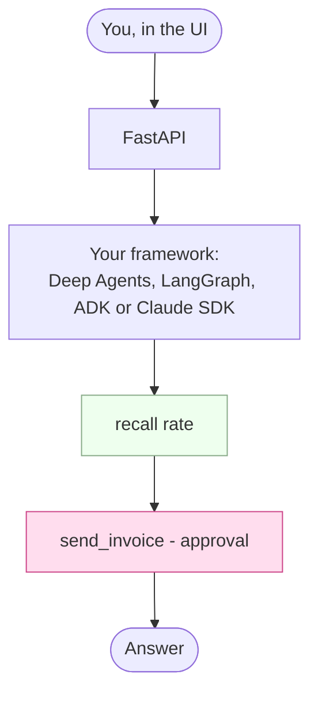

# 057. Send an invoice for side work

**Area:** Bills, budget and money admin  
**Features:** approval, memory

Uses your saved rate from memory. Sending the invoice needs approval.

## What you ask

> Invoice Bright Co for 6 hours of design work.

## Flow



## Tools

| Tool | Effect | Control |
|---|---|---|
| `send_invoice`: Send an invoice. | talks to someone else | approval |

## Approvals

In the UI the run pauses and you decide. With auto-approve (demo), these decisions are used:

- `send_invoice`: approve

## Run it

```bash
python usecases/057_invoice_freelance/usecase.py                 # your preferred framework
python usecases/057_invoice_freelance/usecase.py --all           # all four frameworks
python usecases/057_invoice_freelance/usecase.py --manual        # answer the approvals yourself
python usecases/057_invoice_freelance/usecase.py --framework adk --live   # Gemini decides (needs GOOGLE_API_KEY)
```

Or start the app (`uvicorn app.api:app`), open http://localhost:8000 and pick it from the list.
