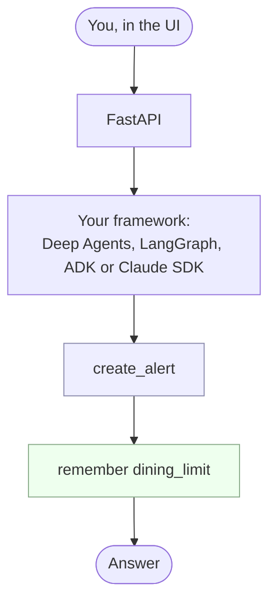

# 058. Set a dining spending alert

**Area:** Bills, budget and money admin  
**Features:** memory

Creates a bank alert and remembers the threshold for the budget review.

## What you ask

> Alert me if dining goes over $250 this month.

## Flow



## Tools

| Tool | Effect | Control |
|---|---|---|
| `create_alert`: Create a spending alert. | changes your data | - |

## Run it

```bash
python usecases/058_set_spending_alert/usecase.py                 # your preferred framework
python usecases/058_set_spending_alert/usecase.py --all           # all four frameworks
python usecases/058_set_spending_alert/usecase.py --manual        # answer the approvals yourself
python usecases/058_set_spending_alert/usecase.py --framework adk --live   # Gemini decides (needs GOOGLE_API_KEY)
```

Or start the app (`uvicorn app.api:app`), open http://localhost:8000 and pick it from the list.
