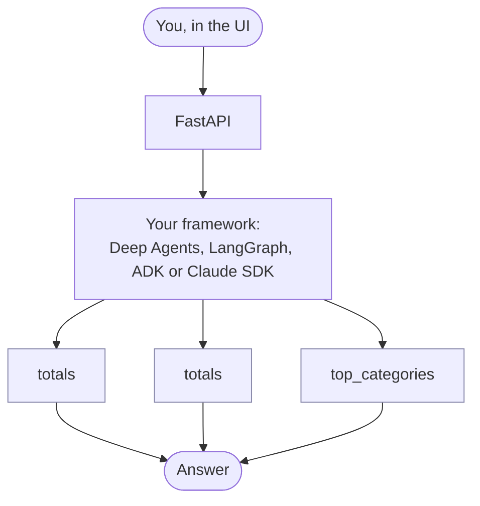

# 060. Year-end money summary

**Area:** Bills, budget and money admin  
**Features:** parallel calls

Income, spending and savings in parallel, as a short report.

## What you ask

> Give me my money summary for the year.

## Flow



## Tools

| Tool | Effect | Control |
|---|---|---|
| `totals`: Yearly totals. | read-only | - |
| `top_categories`: Top spending categories. | read-only | - |

## Run it

```bash
python usecases/060_year_end_money_summary/usecase.py                 # your preferred framework
python usecases/060_year_end_money_summary/usecase.py --all           # all four frameworks
python usecases/060_year_end_money_summary/usecase.py --manual        # answer the approvals yourself
python usecases/060_year_end_money_summary/usecase.py --framework adk --live   # Gemini decides (needs GOOGLE_API_KEY)
```

Or start the app (`uvicorn app.api:app`), open http://localhost:8000 and pick it from the list.
